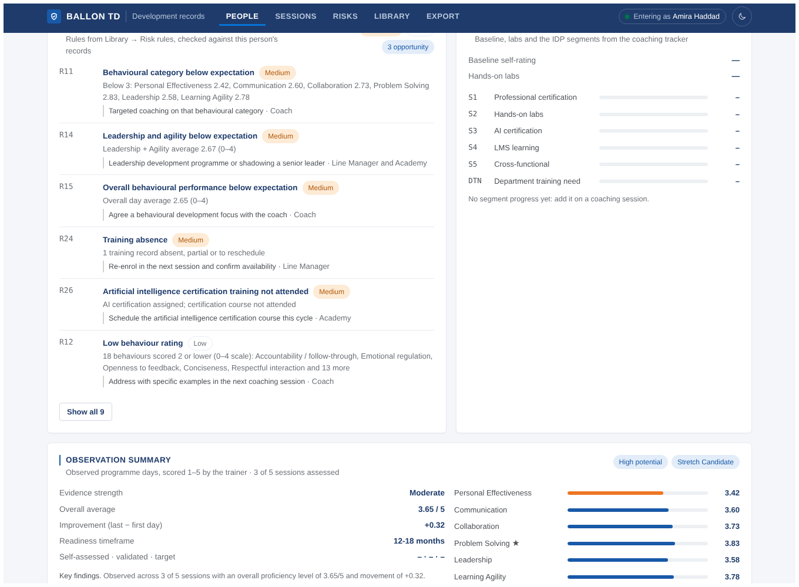

# Ballon TD — development records

An internal web app for recording **every interaction** in an employee development programme, and exporting all of it to **one structured Excel workbook** that can later be imported into a database.

The client cannot use an app, so they only ever receive Excel. Our own team uses this app to enter the data consistently, person by person or session by session. Then we export.

- **No logins, no roles.** It runs on a server inside the VPN. Anyone can open any person and enter anything. Each person types their name once ("Entering as …"). The name is saved with every change, and every change goes into a change log.
- **Standard reference library.** 3 frameworks, 160 competencies with 3,244 behaviour descriptors, 41 role profiles with 620 required levels, 35 courses (workshops, the observed 5-day programme, boot camps, LMS learning and 12 hands-on lab collections), 39 certifications with their spelling variants, 25 observed behaviours, 36 risk and opportunity rules and 47 dropdown lists. See [docs/LIBRARY.md](docs/LIBRARY.md).
- **Every field of the master data.** Baseline survey, IDP segments S1–S5 and department training needs, lab counts, coach validation per behaviour descriptor, segment progress on the coaching tracker, validated and target levels, external IDs of the source platform. See [docs/DATA_MODEL.md](docs/DATA_MODEL.md) and, for loading a client's own workbooks, [docs/MIGRATION.md](docs/MIGRATION.md).
- **Risks and the observation summary, calculated.** 36 rules (critical gaps, behaviour below expectation, labs not started, no coaching …) are checked on every person page and on **Risks**; the observed programme gives evidence strength, leadership potential, readiness timeframe and classification. See [docs/RISK_RULES.md](docs/RISK_RULES.md).
- **One-click export.** `Employee_Summary` (one row per person, all calculated), `Risk_Flags`, `Observation_Profile`, `Activity_Log` (one row per data point, everything in one sheet), `Data_Dictionary`, and one sheet per database table with stable IDs.

React · Express · Prisma · SQLite. It works offline: no web fonts and no CDNs, and the database tables are created with Prisma's WebAssembly engine, so no engine download is needed. The look (navy and royal blue, Arial, capitalised titles, keylines) is described in [docs/DESIGN.md](docs/DESIGN.md).


## Install on the server

Needs **Node.js 20.19 or newer** (22 LTS recommended). Run `npm install` once while the machine has internet access (or copy a `node_modules` folder made on the same OS). After that it runs fully offline.

```bash
git clone https://github.com/Thevaultboy11/ballon-td.git
cd ballon-td
npm install          # also generates the Prisma client
npm run setup        # creates data/app.db and loads the standard library
npm run build        # builds the web app into dist/
npm start            # http://<server>:3000
```

Optional:

```bash
npm run db:demo              # add a fictional demo client with 34 people and a full programme's worth of records
npm run db:demo -- --remove  # remove it again
npm run db:coca-cola         # add a Coca-Cola Global Cyber Security team (36 people, fictional) built on the client templates
npm run db:coca-cola -- --remove
```

`db:coca-cola` follows the client templates: the **Lexonis** competency framework (real codes, categories and definitions, scale 1–4), a baseline survey plus validation interview, IDP segments **S1 professional cert · S2 immersive labs · S3 AI cert · S4 SAP SuccessFactors · S5 cross-functional training** and department training needs, the **coaching table** (preparation, 1-1 start/end, reporting time, segment notes), **coach validation** of each behaviour descriptor with progress 1–5 and evidence, **monthly line-manager validation** per skill, and the observed **5-day cross-functional programme** (S1 Team Collaboration … S5 Problem Solving). The company name is the only real thing in it; every person and record is made up. The full team, role profiles, sessions and what is loaded are listed in [docs/COCA_COLA_DEMO.md](docs/COCA_COLA_DEMO.md).

One step on a fresh server: `npm install && npm run demo:coca-cola && npm run build && npm start`.

Settings go in a `.env` file next to `package.json` (see `.env.example`):

| Variable | Default | Meaning |
| --- | --- | --- |
| `PORT` | `3000` | Port the app listens on |
| `HOST` | `0.0.0.0` | Interface to listen on. Keep `0.0.0.0` to be reachable over the VPN, or set the VPN interface IP |
| `DATABASE_URL` | `file:./data/app.db` | SQLite file. Use an absolute path on a server, e.g. `file:/srv/ballon-td/app.db` |
| `BACKUP_DIR` | `./backups` | Where `npm run db:backup` writes |

**Keep it running** with systemd, pm2 or a Windows service. For example, with pm2: `pm2 start npm --name ballon-td -- start`.

**Back up** with `npm run db:backup` (safe while the app is running). Schedule it nightly, e.g. cron `0 2 * * * cd /srv/ballon-td && npm run db:backup`. The whole database is the one file in `data/`.

**Updating**: `npm run db:backup && git pull && npm install && npm run db:push && npm run db:seed && npm run build`, then restart. `db:push` changes the tables to match the schema and refuses changes that would lose data unless you back up and pass `-- --force`. `db:seed` only adds library items that are missing; it never overwrites your edits (use `npm run db:seed -- --update` to reset them to the library text).

Upgrading from a version before the standard library: the update above adds two tables (BaselineSurvey, RiskRule) and optional columns only, so no data is touched, and the seed adds the new library next to whatever you already have. Existing people keep their role profiles and ratings. If the Coca-Cola demo was loaded before the upgrade, its Lexonis categories already exist, so the library's cross-functional competencies are filed under the demo's framework (*LEXCF*) and the library's own *LEXCROSS* framework stays empty; this is cosmetic.

## Using it

| Page | What you do there |
| --- | --- |
| **People** | Everyone in one table with readiness, gaps, risks (high · medium), leadership potential, plan progress, training, certifications and last coaching. Filter by client, department or readiness. **Add person**. |
| **Person** | The work surface for one person. *Quick add* buttons for each record type (baseline survey, assessment, plan action, training, certification, coaching, validation, evidence). They pre-fill the coach, consultant, programme and line manager. The overview shows **Risks & opportunities**, **Programme progress** (baseline score, labs, S1–S5 and DTN) and the **Observation summary**, then every competency against the role. Tabs list every record by type. **Assessments → Ratings** opens the grid. **History** shows every change: who, when, old → new. |
| **Sessions** | One run of a course. Add participants, then set status, attendance, score and hours for the **whole class at once**. For observed courses, **Observation scores** is a grid of participants × 25 behaviours per day, with the day's title. Type 1–5 and the cursor jumps on. |
| **Risks** | Every risk and opportunity rule with the people and groups it fires for. Filter by client, severity and panel; click a rule to see who. |
| **Library** | The reference data: clients, programmes, staff, competencies and behaviour descriptors, role profiles and requirements, courses and lab collections, certifications, observed behaviours, risk rules, and every dropdown list. Retire items by setting Active to No. |
| **Export** | Everything, one client (for the client's copy) or one person. Untick the change log for files that leave the company. |

Who typically enters what:

| Person | Enters |
| --- | --- |
| Consultant / admin | People, enrolments, assessments and ratings, development plan, manager validations (they arrive by email; set *Source* = "Email from client") |
| Trainer | Sessions: participants, attendance, completion, scores, daily behaviour scores, potential/risk notes; validated and target level per participant |
| Coach | Baseline surveys, coaching sessions with segment progress, plan progress, coach validation of behaviour descriptors (Evidence) |
| Anyone | Certification progress, evidence, corrections |





## Developing

```bash
npm run dev        # API on :3000 with reload + Vite on http://localhost:5173
npm run typecheck
```

| Path | What |
| --- | --- |
| `prisma/schema.prisma` | The database schema (32 tables), with comments |
| `shared/entities.ts` | Every table's fields, labels, dropdown lists and links. The server's validation, the app's forms and tables, and the Excel export all read it. Add a field here and in the schema, then run `npm run db:generate && npm run db:push`. |
| `shared/lookups.ts` | The dropdown lists that get seeded |
| `server/seed/library/*.json` | The standard reference library (frameworks, competencies, descriptors, roles, requirements, catalogue, observed behaviours, risk rules) |
| `server/seed/seed.ts` | Loads the library by business key (safe to run again) |
| `server/seed/starter-library.ts`, `starter.ts` | The small starter library the two demos are built on |
| `server/lib/metrics.ts` | All calculations (readiness, gaps, completion, baseline, labs, segments …) |
| `server/lib/risks.ts` | The 36 risk rules and the observation summary |
| `server/lib/export.ts` | The Excel workbook |
| `server/lib/crud.ts`, `server/routes.ts` | API: generic create/read/update/delete for every table, plus people, ratings grid, session roster and observation grid |
| `client/src` | React app, light and dark themes ([docs/DESIGN.md](docs/DESIGN.md)) |
| `scripts/` | Database push (offline WASM engine), generate, backup, reset, library doc |

| Command | Does |
| --- | --- |
| `npm run db:generate` | Generates the Prisma client (runs automatically after `npm install`) |
| `npm run db:push` | Creates or updates tables to match the schema |
| `npm run db:seed` | Loads the standard library (adds what is missing; `-- --update` overwrites the text) |
| `npm run db:demo` | Adds the fictional demo client |
| `npm run db:coca-cola` | Adds the Coca-Cola security team demo (Lexonis framework, IDP segments, coaching times, monthly validations) |
| `npm run demo:coca-cola` | Setup + library + Coca-Cola team + its document, in one step |
| `npm run docs:coca-cola` | Regenerates `docs/COCA_COLA_DEMO.md` from the database |
| `npm run db:reset` | Backs up and deletes the database, then recreates it with the library |
| `npm run db:backup` | Copies the database to `backups/` |
| `npm run docs:library` | Regenerates `docs/LIBRARY.md` from the library |

## Troubleshooting

- **"Cannot reach the server"** in the browser: the Node process is not running, or the port is blocked on the VPN firewall.
- **`npm install` fails on `better-sqlite3`**: it needs a prebuilt binary for your OS and Node version, downloaded during install. Install with internet access, or install build tools (Python, make and a C++ compiler).
- **"… is not in the … list"** when saving: the value is not a dropdown value. Add it on Library → Lists first.
- **"Someone changed this … after you opened it"**: two people edited the same record. Close the form, reopen it to see their version, then make your change again.
- **Prisma CLI tries to download an engine**: use the npm scripts (`db:generate`, `db:push`). They work offline. `npx prisma studio` and `migrate` need internet access the first time.
