# Ballon TD — development records


Ballon TD is a web app for recording **every interaction** in an employee development programme (assessments, development plans, training, observed programme days, certifications, coaching, manager validations and evidence) and turning it into dashboards, roadmaps, risks, ROI and **one structured Excel workbook**.

The client never has to use the app: they receive the Excel file and reports. Our team uses the app to enter the data the same way every time, person by person or session by session.

- **No logins.** It runs on one computer or server on your network. Everyone types their name once ("Entering as …"); the name is stored with every change and every change goes into a change log.
- **Works offline.** No web fonts, no CDNs, no cloud. After the one-time install, it needs no internet.
- **Ready-made library.** 160 competencies with 3,244 behaviour descriptors, 41 role profiles, 35 courses and lab collections, 39 certifications, 25 observed behaviours, 36 risk rules, 205 KPIs and 49 dropdown lists ([docs/LIBRARY.md](docs/LIBRARY.md)).


## Contents

1. [Quick start (if you already have Node.js)](#1-quick-start-if-you-already-have-nodejs)
2. [Install on Ubuntu, step by step, from a fresh computer](#2-install-on-ubuntu-step-by-step-from-a-fresh-computer)
3. [Keep it running, update, back up](#3-keep-it-running-update-back-up)
4. [A tour of the app](#4-a-tour-of-the-app)
5. [Settings](#5-settings)
6. [Demo data](#6-demo-data)
7. [More documentation](#7-more-documentation)
8. [For developers](#8-for-developers)
9. [Troubleshooting](#9-troubleshooting)

---

## 1. Quick start (if you already have Node.js)

You need **Node.js 20.19 or newer** (22 recommended) and **git**.

```bash
git clone https://github.com/Thevaultboy11/ballon-td.git
cd ballon-td
npm install
npm run demo:coca-cola    # creates the database, loads the library and a demo team
npm run build
npm start                 # then open http://localhost:3000
```

No Node.js yet, or not sure? Follow section 2.

---

## 2. Install on Ubuntu, step by step, from a fresh computer

These steps work on **Ubuntu 22.04 and 24.04** (desktop or server), starting with nothing installed. They take about 10 minutes. You need internet access only during the install. Every command is typed in the **Terminal**; copy a line, paste it with `Ctrl + Shift + V`, press `Enter`, and wait for the prompt (`$`) to come back before the next one.

### Step 1 — Open a terminal

On Ubuntu desktop press **`Ctrl + Alt + T`** (or open *Activities* and type *Terminal*). On a server you are already in one.

### Step 2 — Install the basic tools

```bash
sudo apt update
sudo apt install -y git curl ca-certificates build-essential python3
```

`sudo` asks for your Ubuntu password. Nothing appears while you type it; that is normal. `build-essential` and `python3` are only used if a part of the install has to be compiled on your machine.

### Step 3 — Install Node.js 22

Ubuntu's own Node.js is too old, so install version 22 from NodeSource (the standard Node.js packages for Ubuntu):

```bash
curl -fsSL https://deb.nodesource.com/setup_22.x | sudo -E bash -
sudo apt install -y nodejs
```

Check it worked:

```bash
node -v      # must print v22.x.x (anything from v20.19 works)
npm -v       # prints 10.x or newer
```

### Step 4 — Download Ballon TD

This puts the app in a folder called `ballon-td` in your home folder:

```bash
cd ~
git clone https://github.com/Thevaultboy11/ballon-td.git
cd ballon-td
```

### Step 5 — Install what the app needs

```bash
npm install
```

This downloads the libraries the app uses (a few minutes the first time) and prepares the database code. Warnings in yellow are fine; it has worked when you get the prompt back without a red `ERR!` at the end.

### Step 6 — Create the database

Pick **one** of the two:

```bash
# A) Try it out: an empty database plus a fictional demo team of 36 people with a full programme's worth of records
npm run demo:coca-cola

# B) Real use: an empty database with only the reference library (competencies, roles, courses, rules …)
npm run setup
```

The database is a single file, `data/app.db`, inside the `ballon-td` folder.

### Step 7 — Build the web pages

```bash
npm run build
```

### Step 8 — Start the app

```bash
npm start
```

You will see `Ballon TD running on http://localhost:3000`. Leave this terminal window open: the app runs as long as it is open.

### Step 9 — Open it in the browser

Open Firefox or Chrome on the same computer and go to **http://localhost:3000**. The opening animation plays once each time you open the app in a new tab (click or press any key to skip it). Then type your name: it is stored with everything you enter.

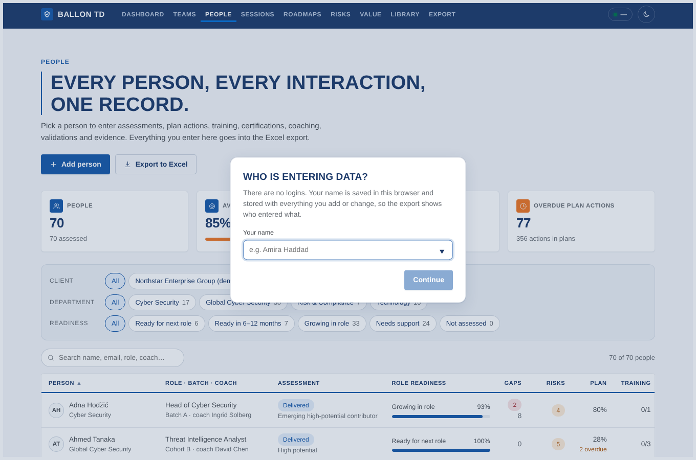

From another computer on the same network, use the address of the computer that runs the app, for example `http://192.168.1.20:3000`. Find that address with:

```bash
hostname -I
```

If the other computer cannot connect, allow the port through Ubuntu's firewall:

```bash
sudo ufw allow 3000/tcp
```

### Step 10 — Stop it and start it again

- **Stop:** click the terminal window and press `Ctrl + C`.
- **Start again later:** open a terminal and run

  ```bash
  cd ~/ballon-td
  npm start
  ```

Your data stays in `data/app.db` between runs. To have the app start by itself when the computer starts, see section 3.

---

## 3. Keep it running, update, back up

### Start automatically with the computer (systemd)

Run this once from the `ballon-td` folder. It creates a background service that starts on boot and restarts the app if it ever stops:

```bash
cd ~/ballon-td
sudo tee /etc/systemd/system/ballon-td.service > /dev/null <<EOF
[Unit]
Description=Ballon TD
After=network.target

[Service]
Type=simple
User=$(whoami)
WorkingDirectory=$(pwd)
ExecStart=$(command -v npm) start
Restart=on-failure

[Install]
WantedBy=multi-user.target
EOF
sudo systemctl daemon-reload
sudo systemctl enable --now ballon-td
```

| You want to … | Command |
| --- | --- |
| See if it is running | `systemctl status ballon-td` |
| Stop / start / restart | `sudo systemctl stop ballon-td` · `start` · `restart` |
| Read its log | `journalctl -u ballon-td -f` |

(When the service runs, don't also start it with `npm start`: both would try to use port 3000.)

### Update to a newer version

```bash
cd ~/ballon-td
npm run db:backup          # safety copy of the database first
git pull
npm install
npm run db:push            # updates the tables; never deletes data
npm run db:seed            # adds new library items; never overwrites your edits
npm run build
sudo systemctl restart ballon-td    # or stop and run npm start again
```

`db:push` refuses changes that would lose data. `db:seed -- --update` resets library text to the shipped version, if you ever want that.

### Back up and restore

```bash
npm run db:backup                      # copies data/app.db to backups/app-<date>.db (safe while the app runs)
```

Schedule it every night at 02:00 with `crontab -e` and this line:

```
0 2 * * * cd /home/YOUR-USER/ballon-td && npm run db:backup
```

To restore, stop the app, delete `data/app.db-wal` and `data/app.db-shm` if they exist, copy a backup over `data/app.db`, and start the app again. The whole database is that one file.

### Start over

```bash
npm run db:reset             # backs up, then recreates an empty database with the library
npm run db:coca-cola         # optional: add the demo team again
```

---

## 4. A tour of the app

The menu at the top has everything. Every page works in light and dark (moon/sun button) and on a phone.

| Page | What it is for |
| --- | --- |
| **Dashboard** | The organisation at a glance: people assessed, critical positions, critical gaps, training, promotion readiness, key-person risk, departments, critical positions and their successors. |
| **Teams** | One department or section: most common gaps, promotion overview, key-person risk, the 9-box, competency and behaviour heatmaps, and every person. |
| **People** | Everyone in one table. Filter, search, **Add person**. |
| **Person** | Everything about one person, with *Quick add* buttons and tabs: Overview, Analysis, Roadmap, Baseline, Assessments, Development plan, Training, Certifications, Coaching, Validations, Evidence, Programmes, History. |
| **Sessions** | One run of a course: participants, attendance and scores for the whole class at once, and the observation grid for observed programmes. |
| **Roadmaps** | Each person's journey in ten stages, rolled up per department, section or line manager's team, with a manager report. |
| **Risks** | 36 risk and opportunity rules and who they fire for. |
| **Value** | For executives: investment, return, ROI, payback, value delivered and the KPI scorecard. |
| **Library** | The reference data and every dropdown list. |
| **Export** | One Excel workbook: everything, one client or one person. |

**Dashboard and Teams** — where to act: gaps, successors, key people and the 9-box.

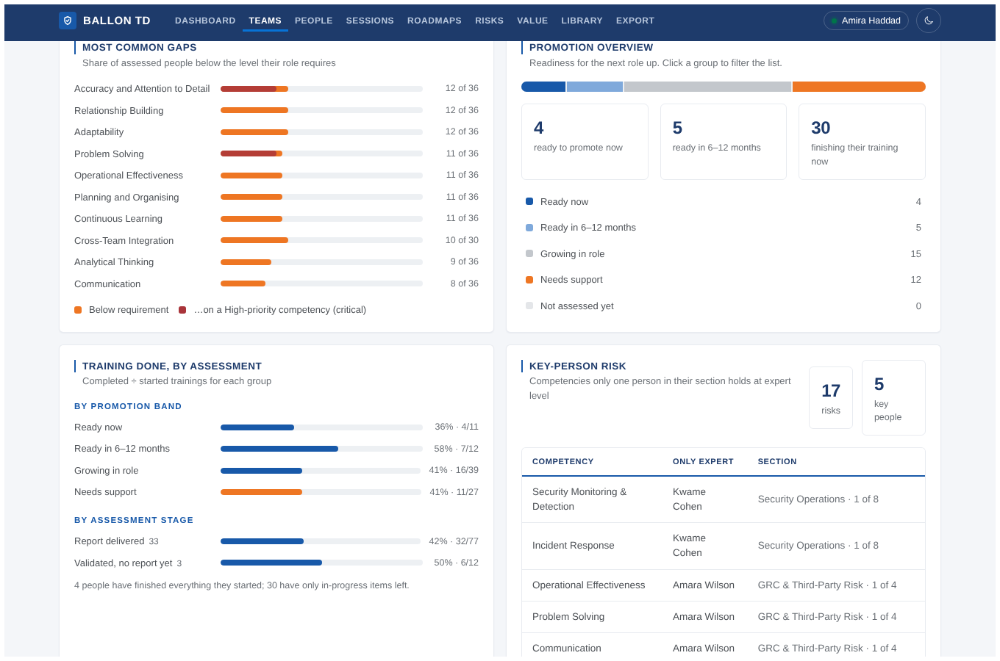

**People** — the list everyone starts from.

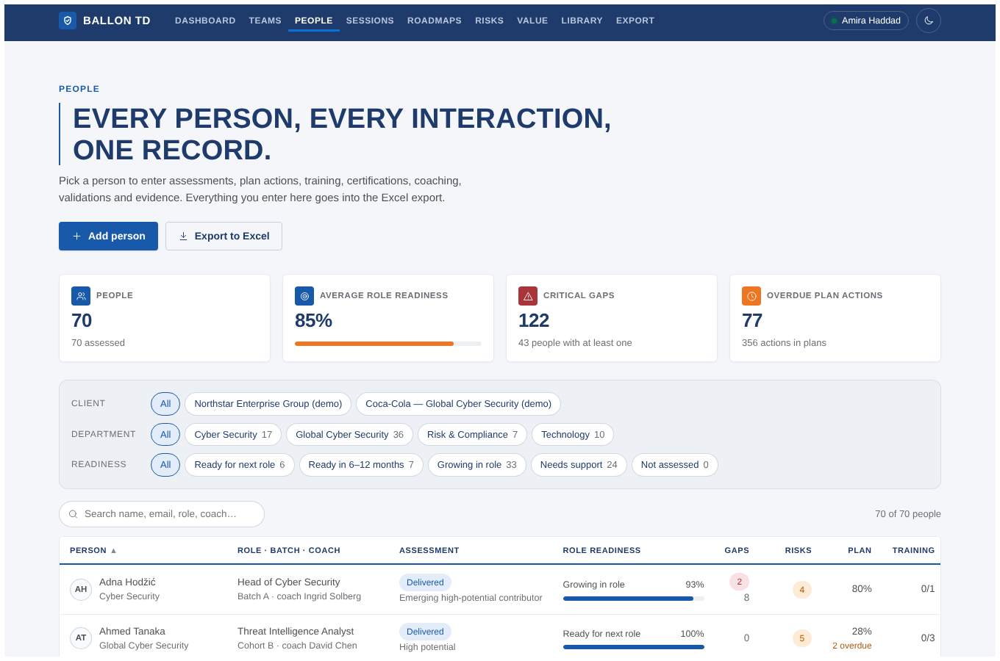

**Person** — the work surface. Readiness, gaps, plan and training at the top, risks and progress on the overview.


**Adding a record** — every *Quick add* button opens a form on the right, pre-filled with the person, coach and programme. `Ctrl + Enter` saves.

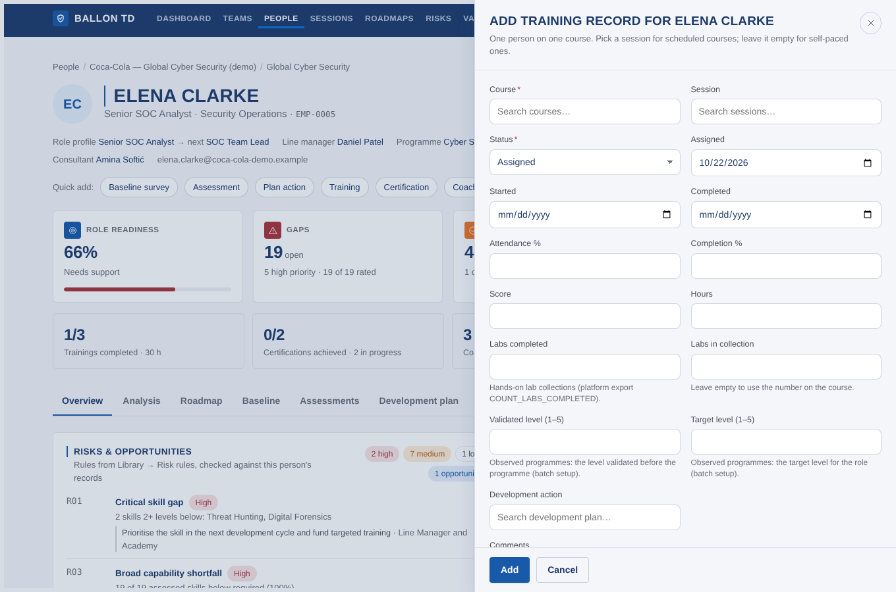

**Ratings** — Assessments → Ratings: click a level per competency; the required level comes from the role profile.

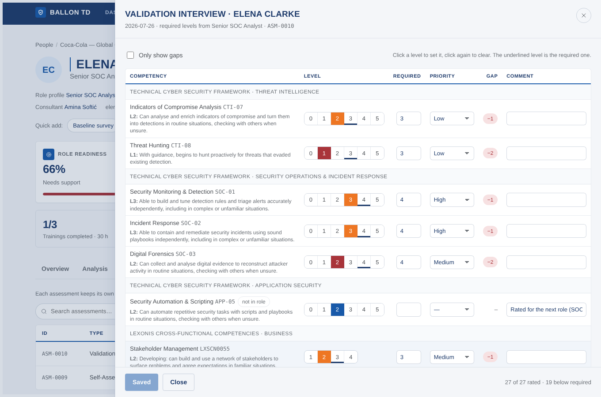

**Analysis** — the competency radar, what to grow for the next role, observed behaviours day by day, training and certifications.

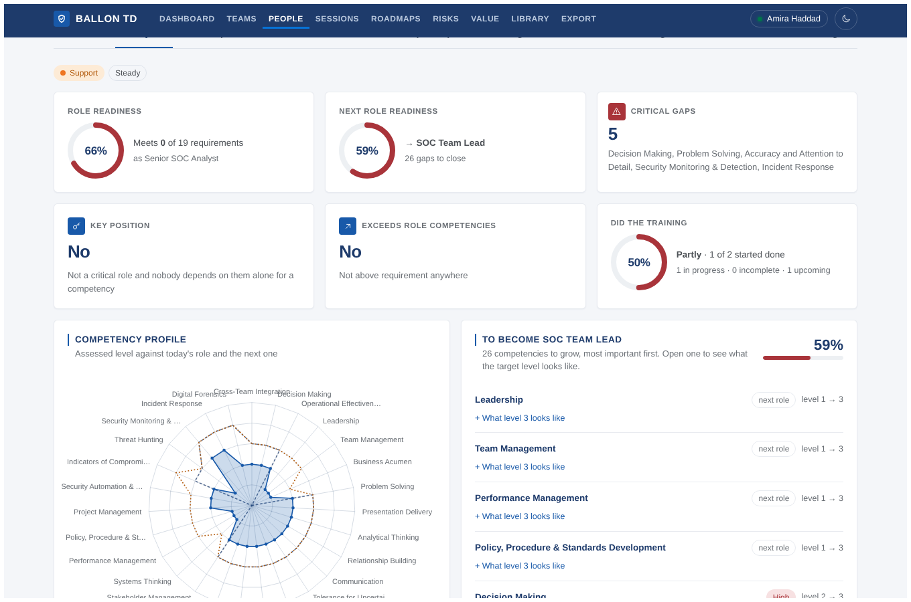

**Roadmap** — the person's journey left to right: what is done and what is still open in each stage, and a dated timeline.


**Observation grid** — trainers score 25 behaviours per participant per day; type 1–5 and the cursor jumps on.

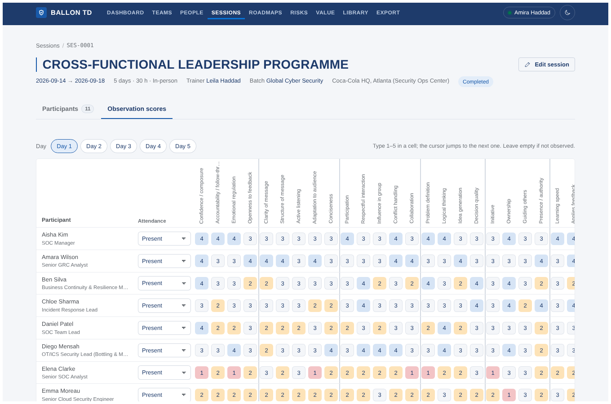

**Risks** — every rule with the people and groups it fires for.

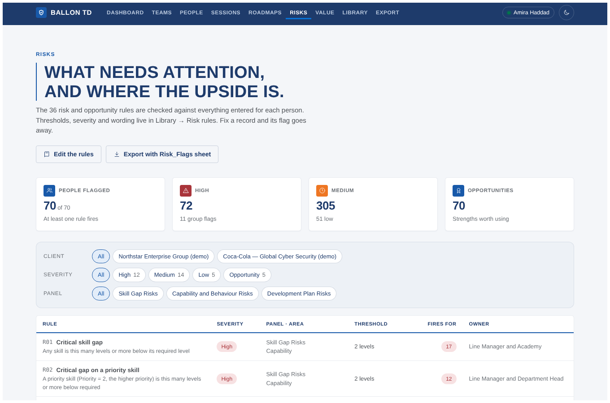

**Value & ROI** — what was invested, what came back, and why. Every rate shows its source and can be changed.

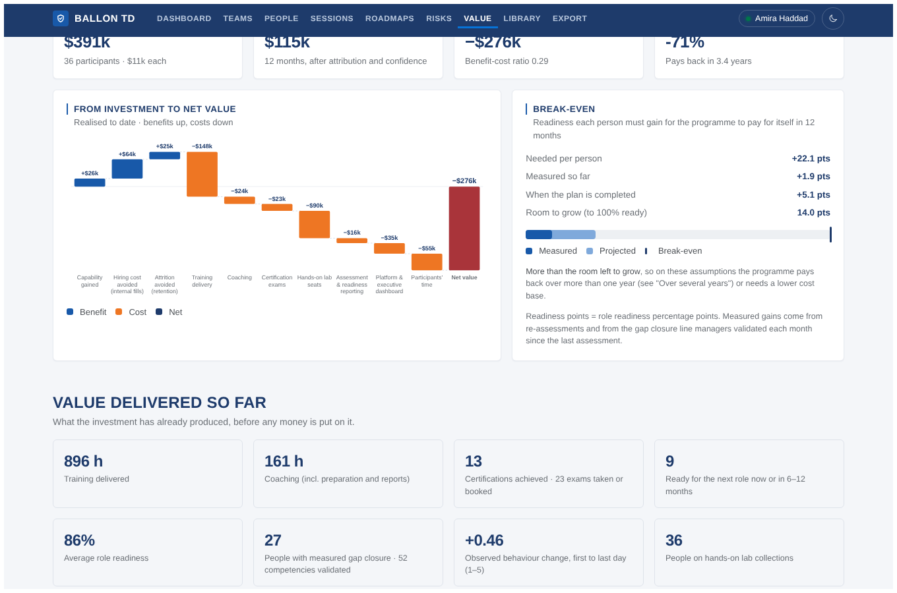

**Library and Export**

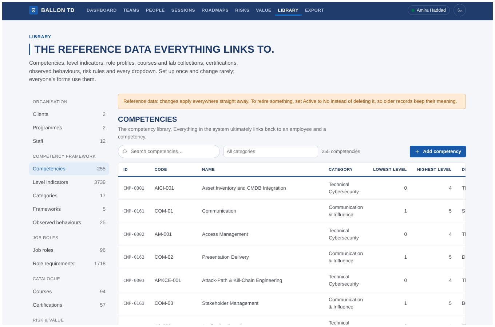
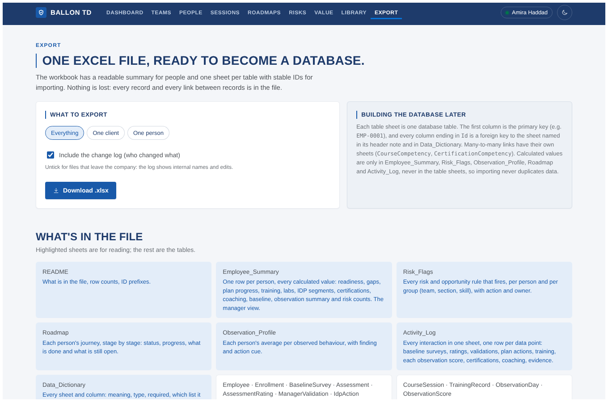

**Dark mode and phone**

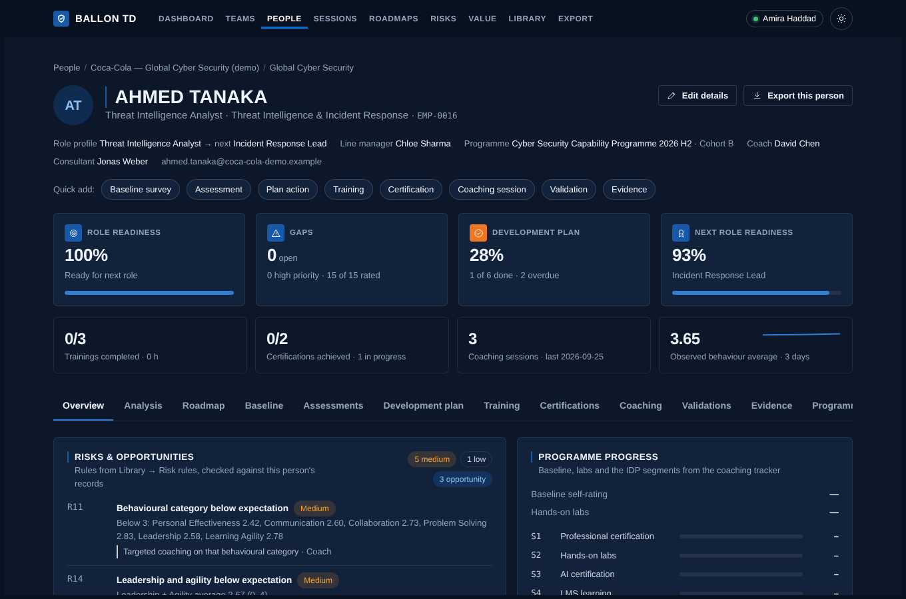

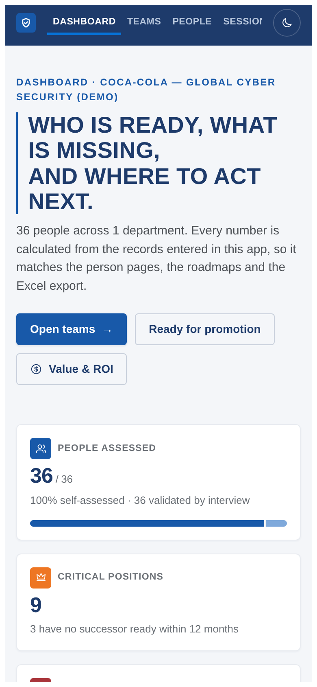

### Who enters what

| Person | Enters |
| --- | --- |
| Consultant / admin | People, enrolments, assessments and ratings, development plan, manager validations (they arrive by email; set *Source* = "Email from client") |
| Trainer | Sessions: participants, attendance, completion, scores, daily behaviour scores, notes; validated and target level per participant |
| Coach | Baseline surveys, coaching sessions with segment progress, plan progress, coach validation of behaviour descriptors (Evidence) |
| Anyone | Certification progress, evidence, corrections |

---

## 5. Settings

Settings go in a file called `.env` in the `ballon-td` folder. Start from the example:

```bash
cp .env.example .env
nano .env        # change what you need, then Ctrl + O, Enter, Ctrl + X
```

| Setting | Default | Meaning |
| --- | --- | --- |
| `PORT` | `3000` | Port the app listens on |
| `HOST` | `0.0.0.0` | `0.0.0.0` = reachable from other computers; `127.0.0.1` = only this computer |
| `DATABASE_URL` | `file:./data/app.db` | The database file. On a server use an absolute path, e.g. `file:/srv/ballon-td/app.db` |
| `BACKUP_DIR` | `./backups` | Where `npm run db:backup` writes |

Restart the app after changing `.env`.

---

## 6. Demo data

| Command | Adds | Remove with |
| --- | --- | --- |
| `npm run db:coca-cola` | A fictional **Coca-Cola Global Cyber Security** team: 36 people on the client templates (cross-functional framework, baseline survey, IDP segments S1–S5, coaching tracker, monthly validations, the observed 5-day programme). Listed in [docs/COCA_COLA_DEMO.md](docs/COCA_COLA_DEMO.md) | `npm run db:coca-cola -- --remove` |
| `npm run db:demo` | A fictional client with 34 people and a full programme's worth of records | `npm run db:demo -- --remove` |

The company name is the only real thing in the Coca-Cola demo; every person and record is made up.

---

## 7. More documentation

| Document | About |
| --- | --- |
| [docs/DASHBOARD.md](docs/DASHBOARD.md) | Dashboard, Teams and Analysis: what each number means |
| [docs/VALUE.md](docs/VALUE.md) | Value & ROI: method, assumptions and how to read the result |
| [docs/ROADMAP.md](docs/ROADMAP.md) | The ten-stage roadmap and the manager report |
| [docs/RISK_RULES.md](docs/RISK_RULES.md) | The 36 risk and opportunity rules |
| [docs/DATA_MODEL.md](docs/DATA_MODEL.md) | Tables, links, calculations and the Excel export |
| [docs/LIBRARY.md](docs/LIBRARY.md) | Everything the reference library contains |
| [docs/MIGRATION.md](docs/MIGRATION.md) | Loading a client's existing workbooks |
| [docs/DESIGN.md](docs/DESIGN.md) | Colours, type, keylines, the opening animation |
| [docs/COCA_COLA_DEMO.md](docs/COCA_COLA_DEMO.md) | The demo team |

---

## 8. For developers

React · Express · Prisma · SQLite. The database tables are created with Prisma's WebAssembly engine, so no engine download is needed.

```bash
npm run dev        # API on :3000 with reload + Vite on http://localhost:5173
npm run typecheck
```

| Path | What |
| --- | --- |
| `prisma/schema.prisma` | The database schema (33 tables), with comments |
| `shared/entities.ts` | Every table's fields, labels, lists and links; validation, forms, tables and the export all read it. Add a field here and in the schema, then `npm run db:generate && npm run db:push` |
| `shared/lookups.ts` | The dropdown lists that get seeded |
| `server/seed/library/*.json` | The reference library, value assumptions and KPI catalogue |
| `server/seed/seed.ts` | Loads the library by business key (safe to run again) |
| `server/lib/metrics.ts` | Readiness, gaps, completion, baseline, labs, segments … |
| `server/lib/risks.ts` | The 36 risk rules and the observation summary |
| `server/lib/dashboard.ts` | Dashboard, teams and person analysis |
| `server/lib/value.ts` | Value & ROI and the KPI scorecard |
| `server/lib/roadmap.ts`, `roadmap-report.ts` | Roadmaps and the manager report |
| `server/lib/export.ts` | The Excel workbook |
| `server/lib/crud.ts`, `server/routes.ts` | The API |
| `client/index.html` | Page shell and the opening animation |
| `client/src` | The React app |
| `scripts/` | Database push (offline), generate, backup, reset, docs |

| Command | Does |
| --- | --- |
| `npm run setup` | Generate the Prisma client, create the tables, load the library |
| `npm run db:push` | Create or update tables to match the schema |
| `npm run db:seed` | Load the library (adds what is missing; `-- --update` overwrites the text) |
| `npm run db:reset` | Back up, delete and recreate the database with the library |
| `npm run db:backup` | Copy the database to `backups/` |
| `npm run docs:library` | Regenerate `docs/LIBRARY.md` |
| `npm run docs:coca-cola` | Regenerate `docs/COCA_COLA_DEMO.md` from the database |

---

## 9. Troubleshooting

| Problem | Fix |
| --- | --- |
| `node: command not found` or `node -v` shows v12/v18 | Do step 3 again; the NodeSource lines replace Ubuntu's old Node.js. Then close and reopen the terminal |
| `npm install` ends with `ERR!` about `better-sqlite3` | Make sure step 2 ran (`build-essential`, `python3`), then `rm -rf node_modules && npm install` |
| `EADDRINUSE: address already in use :3000` | The app is already running (maybe as the service). Use it, or stop the other copy: `sudo systemctl stop ballon-td`, or find it with `ss -ltnp \| grep 3000`. Or set another `PORT` in `.env` |
| The browser says it cannot connect | The app is not running: start it (step 8) or check `systemctl status ballon-td`. From another computer, use the right address (`hostname -I`) and allow the port (`sudo ufw allow 3000/tcp`) |
| The page is blank or old after an update | Run `npm run build` and restart the app, then reload the page with `Ctrl + Shift + R` |
| "… is not in the … list" when saving | The value is not a dropdown value. Add it on Library → Lists first |
| "Someone changed this … after you opened it" | Two people edited the same record. Close the form, reopen it to see their version, then make your change again |
| I want to skip the opening animation | Click it or press any key. It plays once when the app is opened in a new tab, not on reloads or page changes. Adding `?intro=0` to the address skips it |
| Prisma tries to download an engine | Use the npm scripts (`db:generate`, `db:push`); they work offline. `npx prisma studio` and `migrate` need the internet the first time |
