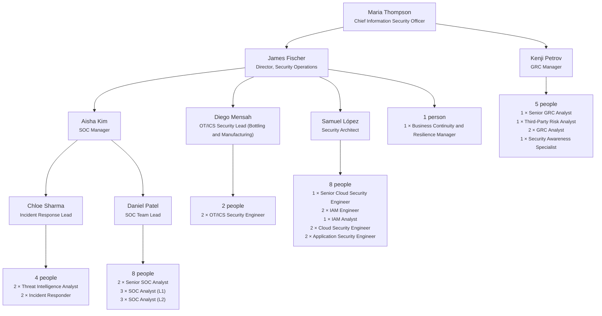

# Coca-Cola Global Cyber Security — demo data

A fictional cyber security team for **Coca-Cola — Global Cyber Security (demo)**, built to show the app with realistic data. The company name is the only real thing in it: every person, email (`@coca-cola-demo.example`), score and note is made up. Generated by `npm run docs:coca-cola` on 2026-10-22 — do not edit by hand.

## Commands

| Command | Does |
| --- | --- |
| `npm run demo:coca-cola` | **One step**: creates the database if needed, loads the library, loads the Coca-Cola team and rewrites this document |
| `npm run db:coca-cola` | Loads the Coca-Cola team only (the library is added first if it is missing) |
| `npm run db:coca-cola -- --remove` | Removes the client, its 36 people, their records and the 24 Coca-Cola role profiles (the Lexonis framework and added courses stay) |
| `npm run db:coca-cola -- --remove && npm run db:coca-cola` | Reloads it from scratch |
| `npm run docs:coca-cola` | Rewrites this document from the database |

Fresh server: `npm install && npm run demo:coca-cola && npm run build && npm start`, then open People and pick the Coca-Cola client chip.

## At a glance

| People | Role profiles | Average role readiness | Critical gaps | Ready for next role | Ready in 6–12 months | Growing in role | Needs support |
| --- | --- | --- | --- | --- | --- | --- | --- |
| 36 | 24 | 86% | 58 | 4 | 5 | 15 | 12 |

| Record type | Rows |
| --- | ---: |
| Programme enrolments | 36 |
| Assessments (baseline survey + validation interview) | 72 |
| Competency ratings | 1,562 |
| Development plan actions (S1–S5, department needs, workplace assignments) | 268 |
| Training records | 118 |
| Observation days | 85 |
| Observation scores | 2,050 |
| Certification records | 72 |
| Coaching sessions | 108 |
| Manager validations (interview sign-off + monthly progress) | 191 |
| Evidence (coach validation per behaviour descriptor) | 236 |

## Team structure

Reporting lines (line manager → report).

## Sections

| Section | People | Average role readiness | Critical gaps | Ready for next role or within 12 months |
| --- | ---: | ---: | ---: | ---: |
| Threat Intelligence & Incident Response | 5 | 85% | 7 | 3 |
| Security Operations | 10 | 88% | 15 | 2 |
| GRC & Third-Party Risk | 5 | 78% | 15 | 2 |
| Awareness & Resilience | 2 | 82% | 4 | 0 |
| OT Security | 3 | 93% | 3 | 1 |
| Cloud & Identity | 7 | 81% | 12 | 0 |
| CISO Office | 2 | 97% | 2 | 1 |
| Application Security | 2 | 99% | 0 | 0 |

## The professionals

All 36 people, sorted by section and seniority. Readiness and gaps are calculated from the validation interview against the role profile.

| ID | Name | Role | Section | Location | Line manager | Coach | Role readiness | Next role (readiness) | Gaps (critical) | Band |
| --- | --- | --- | --- | --- | --- | --- | ---: | --- | ---: | --- |
| `EMP-0028` | Marek Ferrari | Application Security Engineer | Application Security | Mexico City, MX | Samuel López | David Chen | 100% | Security Architect (78%) | 0 (0) | Growing in role |
| `EMP-0029` | Zoe Rossi | Application Security Engineer | Application Security | Mexico City, MX | Samuel López | Sofia Martins | 97% | Security Architect (71%) | 1 (0) | Growing in role |
| `EMP-0036` | Ben Silva | Business Continuity & Resilience Manager | Awareness & Resilience | Atlanta, US | James Fischer | David Chen | 98% | Director, Security Operations (78%) | 2 (0) | Growing in role |
| `EMP-0035` | Yara Becker | Security Awareness Specialist | Awareness & Resilience | Sarajevo, BA | Kenji Petrov | Sofia Martins | 67% | Senior GRC Analyst (56%) | 10 (4) | Needs support |
| `EMP-0001` | Maria Thompson | Chief Information Security Officer | CISO Office | Atlanta, US | — | Sofia Martins | 97% | — (–) | 3 (1) | Growing in role |
| `EMP-0002` | James Fischer | Director, Security Operations | CISO Office | Atlanta, US | Maria Thompson | David Chen | 98% | Chief Information Security Officer (97%) | 2 (1) | Ready in 6–12 months |
| `EMP-0024` | Samuel López | Security Architect | Cloud & Identity | Shanghai, CN | James Fischer | David Chen | 96% | Director, Security Operations (77%) | 3 (1) | Growing in role |
| `EMP-0021` | Emma Moreau | Senior Cloud Security Engineer | Cloud & Identity | Sofia, BG | Samuel López | Sofia Martins | 84% | Security Architect (75%) | 9 (3) | Needs support |
| `EMP-0025` | Fatima Martin | IAM Engineer | Cloud & Identity | Mexico City, MX | Samuel López | Sofia Martins | 86% | Security Architect (53%) | 5 (0) | Growing in role |
| `EMP-0023` | Julia Rahman | Cloud Security Engineer | Cloud & Identity | Atlanta, US | Samuel López | Sofia Martins | 50% | Senior Cloud Security Engineer (37%) | 13 (4) | Needs support |
| `EMP-0026` | Noah Adeyemi | IAM Engineer | Cloud & Identity | Sarajevo, BA | Samuel López | David Chen | 76% | Security Architect (52%) | 6 (2) | Needs support |
| `EMP-0022` | Ravi Lindqvist | Cloud Security Engineer | Cloud & Identity | Atlanta, US | Samuel López | David Chen | 100% | Senior Cloud Security Engineer (82%) | 0 (0) | Growing in role |
| `EMP-0027` | Ines Diallo | IAM Analyst | Cloud & Identity | Atlanta, US | Samuel López | Sofia Martins | 75% | IAM Engineer (67%) | 6 (2) | Needs support |
| `EMP-0030` | Kenji Petrov | GRC Manager | GRC & Third-Party Risk | Sarajevo, BA | Maria Thompson | David Chen | 75% | Chief Information Security Officer (58%) | 20 (7) | Needs support |
| `EMP-0031` | Amara Wilson | Senior GRC Analyst | GRC & Third-Party Risk | Sofia, BG | Kenji Petrov | Sofia Martins | 100% | GRC Manager (100%) | 0 (0) | Ready for next role |
| `EMP-0034` | Erik García | Third-Party Risk Analyst | GRC & Third-Party Risk | Dublin, IE | Kenji Petrov | David Chen | 64% | Senior GRC Analyst (51%) | 12 (4) | Needs support |
| `EMP-0032` | Luca Horvat | GRC Analyst | GRC & Third-Party Risk | Atlanta, US | Kenji Petrov | David Chen | 51% | Senior GRC Analyst (40%) | 13 (4) | Needs support |
| `EMP-0033` | Selin Nasser | GRC Analyst | GRC & Third-Party Risk | Atlanta, US | Kenji Petrov | Sofia Martins | 100% | Senior GRC Analyst (85%) | 0 (0) | Ready in 6–12 months |
| `EMP-0018` | Diego Mensah | OT/ICS Security Lead (Bottling & Manufacturing) | OT Security | Shanghai, CN | James Fischer | David Chen | 100% | Director, Security Operations (85%) | 0 (0) | Ready in 6–12 months |
| `EMP-0019` | Nadia Dubois | OT/ICS Security Engineer | OT Security | Sarajevo, BA | Diego Mensah | Sofia Martins | 86% | OT/ICS Security Lead (Bottling & Manufacturing) (72%) | 4 (2) | Growing in role |
| `EMP-0020` | Tomasz Kowalski | OT/ICS Security Engineer | OT Security | Shanghai, CN | Diego Mensah | David Chen | 92% | OT/ICS Security Lead (Bottling & Manufacturing) (76%) | 3 (1) | Growing in role |
| `EMP-0003` | Aisha Kim | SOC Manager | Security Operations | Atlanta, US | James Fischer | Sofia Martins | 100% | Director, Security Operations (85%) | 0 (0) | Growing in role |
| `EMP-0004` | Daniel Patel | SOC Team Lead | Security Operations | Shanghai, CN | Aisha Kim | David Chen | 96% | SOC Manager (92%) | 3 (1) | Ready in 6–12 months |
| `EMP-0005` | Elena Clarke | Senior SOC Analyst | Security Operations | Shanghai, CN | Daniel Patel | Sofia Martins | 66% | SOC Team Lead (59%) | 19 (5) | Needs support |
| `EMP-0006` | Kwame Cohen | Senior SOC Analyst | Security Operations | Dublin, IE | Daniel Patel | David Chen | 100% | SOC Team Lead (98%) | 0 (0) | Ready for next role |
| `EMP-0008` | Lucas Haddad | SOC Analyst (L2) | Security Operations | Sofia, BG | Daniel Patel | David Chen | 88% | Senior SOC Analyst (68%) | 3 (3) | Growing in role |
| `EMP-0009` | Priya Begović | SOC Analyst (L2) | Security Operations | Atlanta, US | Daniel Patel | Sofia Martins | 92% | Senior SOC Analyst (71%) | 3 (0) | Growing in role |
| `EMP-0007` | Sofia Novak | SOC Analyst (L2) | Security Operations | Atlanta, US | Daniel Patel | Sofia Martins | 64% | Senior SOC Analyst (49%) | 12 (4) | Needs support |
| `EMP-0011` | Hannah Yilmaz | SOC Analyst (L1) | Security Operations | Sofia, BG | Daniel Patel | Sofia Martins | 92% | SOC Analyst (L2) (80%) | 2 (1) | Growing in role |
| `EMP-0010` | Mateo Jensen | SOC Analyst (L1) | Security Operations | Sarajevo, BA | Daniel Patel | David Chen | 97% | SOC Analyst (L2) (84%) | 1 (0) | Growing in role |
| `EMP-0012` | Omar Okafor | SOC Analyst (L1) | Security Operations | Sarajevo, BA | Daniel Patel | David Chen | 85% | SOC Analyst (L2) (76%) | 4 (1) | Growing in role |
| `EMP-0013` | Chloe Sharma | Incident Response Lead | Threat Intelligence & Incident Response | Dublin, IE | Aisha Kim | Sofia Martins | 95% | SOC Manager (92%) | 4 (0) | Ready in 6–12 months |
| `EMP-0016` | Ahmed Tanaka | Threat Intelligence Analyst | Threat Intelligence & Incident Response | Atlanta, US | Chloe Sharma | David Chen | 100% | Incident Response Lead (93%) | 0 (0) | Ready for next role |
| `EMP-0015` | Grace Costa | Incident Responder | Threat Intelligence & Incident Response | Atlanta, US | Chloe Sharma | Sofia Martins | 68% | Incident Response Lead (55%) | 10 (3) | Needs support |
| `EMP-0014` | Ivan Hassan | Incident Responder | Threat Intelligence & Incident Response | Sofia, BG | Chloe Sharma | David Chen | 63% | Incident Response Lead (41%) | 10 (4) | Needs support |
| `EMP-0017` | Laura Park | Threat Intelligence Analyst | Threat Intelligence & Incident Response | Shanghai, CN | Chloe Sharma | Sofia Martins | 100% | Incident Response Lead (95%) | 0 (0) | Ready for next role |

## Role profiles

Requirements combine the Lexonis framework (scale 1–4) with technical competencies (scale 0–5). Required levels rise with seniority; editable on Library → Role requirements.

| Code | Role | Seniority | Next role | Requirements | High-priority requirements (level) |
| --- | --- | --- | --- | ---: | --- |
| `KO-APPSEC` | Application Security Engineer | Mid | Security Architect | 15 | Application Security Review 3 · Secure Development 3 · Problem Solving 2 · Accuracy and Attention to Detail 2 |
| `KO-ARCH` | Security Architect | Lead | Director, Security Operations | 25 | Cloud Security 4 · Security Architecture 4 · Decision Making 3 · Leadership 3 · Team Management 3 · Performance Management 3 |
| `KO-AWR` | Security Awareness Specialist | Mid | Senior GRC Analyst | 14 | Policy & Standards Development 3 · Security Awareness 3 · Problem Solving 2 · Accuracy and Attention to Detail 2 |
| `KO-BCM` | Business Continuity & Resilience Manager | Manager | Director, Security Operations | 29 | Business Continuity Planning 3 · Business Impact Analysis 3 · Strategic Thinking 3 · Strategic Influence 3 · Decision Making 3 · Leadership 3 · Team Management 3 · Performance Management 3 |
| `KO-CISO` | Chief Information Security Officer | Executive | — | 29 | Security & Risk Governance 3 · Risk Assessment 3 · Strategic Thinking 4 · Strategic Influence 4 · Decision Making 4 · Leadership 4 · Team Management 4 · Performance Management 4 |
| `KO-CLD-EN` | Cloud Security Engineer | Mid | Senior Cloud Security Engineer | 15 | Cloud Security 3 · System Hardening 3 · Problem Solving 2 · Accuracy and Attention to Detail 2 |
| `KO-CLD-SR` | Senior Cloud Security Engineer | Senior | Security Architect | 18 | Cloud Security 4 · Security Architecture 4 · Decision Making 3 · Problem Solving 3 · Accuracy and Attention to Detail 3 |
| `KO-CTI` | Threat Intelligence Analyst | Mid | Incident Response Lead | 15 | Threat Intelligence Lifecycle 3 · Threat Actor Profiling 3 · Problem Solving 2 · Accuracy and Attention to Detail 2 |
| `KO-DIR-SO` | Director, Security Operations | Head | Chief Information Security Officer | 29 | Risk Assessment 3 · Incident Response 3 · Strategic Thinking 4 · Strategic Influence 4 · Decision Making 4 · Leadership 4 · Team Management 4 · Performance Management 4 |
| `KO-GRC-AN` | GRC Analyst | Entry | Senior GRC Analyst | 15 | Risk Assessment 2 · Compliance Management 2 · Problem Solving 2 · Accuracy and Attention to Detail 2 · Policy, Procedure & Standards Development 3 |
| `KO-GRC-MGR` | GRC Manager | Manager | Chief Information Security Officer | 29 | Security & Risk Governance 3 · Risk Assessment 3 · Strategic Thinking 3 · Strategic Influence 3 · Decision Making 3 · Leadership 3 · Team Management 3 · Performance Management 3 · Policy, Procedure & Standards Development 3 |
| `KO-GRC-SR` | Senior GRC Analyst | Senior | GRC Manager | 20 | Risk Assessment 4 · Risk Treatment Planning 4 · Decision Making 3 · Problem Solving 3 · Accuracy and Attention to Detail 3 · Policy, Procedure & Standards Development 3 |
| `KO-IAM-AN` | IAM Analyst | Entry | IAM Engineer | 12 | Identity Management 2 · Access Control 2 · Problem Solving 2 · Accuracy and Attention to Detail 2 |
| `KO-IAM-EN` | IAM Engineer | Mid | Security Architect | 14 | Identity Management 3 · Access Control 3 · Problem Solving 2 · Accuracy and Attention to Detail 2 |
| `KO-IR` | Incident Responder | Mid | Incident Response Lead | 14 | Incident Response 3 · Digital Forensics 3 · Problem Solving 2 · Accuracy and Attention to Detail 2 |
| `KO-IR-LD` | Incident Response Lead | Lead | SOC Manager | 25 | Incident Response 4 · Digital Forensics 4 · Decision Making 3 · Leadership 3 · Team Management 3 · Performance Management 3 |
| `KO-OT-EN` | OT/ICS Security Engineer | Mid | OT/ICS Security Lead (Bottling & Manufacturing) | 15 | Network Security 3 · Problem Solving 2 · Accuracy and Attention to Detail 2 · OT/ICS Security 3 |
| `KO-OT-LD` | OT/ICS Security Lead (Bottling & Manufacturing) | Lead | Director, Security Operations | 26 | Network Security 4 · Decision Making 3 · Leadership 3 · Team Management 3 · Performance Management 3 · OT/ICS Security 4 |
| `KO-SOC-L1` | SOC Analyst (L1) | Entry | SOC Analyst (L2) | 13 | Security Monitoring & Detection 2 · Incident Response 2 · Problem Solving 2 · Accuracy and Attention to Detail 2 |
| `KO-SOC-L2` | SOC Analyst (L2) | Mid | Senior SOC Analyst | 15 | Security Monitoring & Detection 3 · Incident Response 3 · Problem Solving 2 · Accuracy and Attention to Detail 2 |
| `KO-SOC-LD` | SOC Team Lead | Lead | SOC Manager | 26 | Security Monitoring & Detection 4 · Incident Response 4 · Decision Making 3 · Leadership 3 · Team Management 3 · Performance Management 3 |
| `KO-SOC-MGR` | SOC Manager | Manager | Director, Security Operations | 28 | Security Monitoring & Detection 3 · Incident Response 3 · Strategic Thinking 3 · Strategic Influence 3 · Decision Making 3 · Leadership 3 · Team Management 3 · Performance Management 3 |
| `KO-SOC-SR` | Senior SOC Analyst | Senior | SOC Team Lead | 19 | Security Monitoring & Detection 4 · Incident Response 4 · Decision Making 3 · Problem Solving 3 · Accuracy and Attention to Detail 3 |
| `KO-TPR` | Third-Party Risk Analyst | Mid | Senior GRC Analyst | 15 | Risk Assessment 3 · Risk Treatment Planning 3 · Problem Solving 2 · Accuracy and Attention to Detail 2 |

## Lexonis competency framework

Codes, categories and definitions from the client's competency sheet. Level indicators (1 Foundation · 2 Developing · 3 Proficient · 4 Expert) are starter text.

| Code | Competency | Framework · category | Scale | Definition |
| --- | --- | --- | --- | --- |
| `LXSCN0055` | **Stakeholder Management** | Lexonis Cross-functional Competencies · Business | 1–4 | Builds a broad network of relationships with stakeholders to identify problems and opportunities for improvement and structure performance expectations. |
| `LXSCN0060` | **Systems Thinking** | Lexonis Cross-functional Competencies · Business | 1–4 | Focuses on big picture thinking, combining data and insights into useful strategies and actions. |
| `LXSCN0080` | **Budgeting** | Lexonis Cross-functional Competencies · Business | 1–4 | Identifies and incorporates financial resources into a comprehensive financial plan that supports business strategies. |
| `LXSCN0001` | **Cross-Team Integration** | Lexonis Cross-functional Competencies · Leadership and Management | 1–4 | Leads multiple teams to communicate and coordinate work as one team. |
| `LXSCN0005` | **Strategic Thinking** | Lexonis Cross-functional Competencies · Leadership and Management | 1–4 | Envisions the long-term direction of the organisation, anticipates future trends, develops plans that position the company for sustained success and pursues high potential opportunities for the benefit of the organisation. |
| `LXSCN0008` | **Strategic Influence** | Lexonis Cross-functional Competencies · Leadership and Management | 1–4 | Develops and leverages internal/external relationships to facilitate decision-making. |
| `LXSCN0019` | **Decision Making** | Lexonis Cross-functional Competencies · Leadership and Management | 1–4 | Makes sound decisions in a timely manner, exercising a combination of analysis and good judgement. |
| `LXSCN0020` | **Operational Effectiveness** | Lexonis Cross-functional Competencies · Leadership and Management | 1–4 | Drives organisational success by optimising operations, improving efficiencies and maximising business performance. |
| `LXSCN0026` | **Leadership** | Lexonis Cross-functional Competencies · Leadership and Management | 1–4 | Creates a motivating vision, serves as a role model, rallies others in support of the chosen direction, and motivates people to embrace and lead change. |
| `LXSCN0027` | **Team Management** | Lexonis Cross-functional Competencies · Leadership and Management | 1–4 | Guides group efforts and helps others achieve excellent results. |
| `LXSCN0206` | **Performance Management** | Lexonis Cross-functional Competencies · Leadership and Management | 0–4 | Works with individuals and teams to set expectations, monitor progress, provide feedback and support and evaluate their performance. |
| `LXSCN0030` | **Business Acumen** | Lexonis Cross-functional Competencies · Personal | 1–4 | Focuses activities and decisions on opportunities that produce significant, strategic business impact. |
| `LXSCN0031` | **Problem Solving** | Lexonis Cross-functional Competencies · Personal | 1–4 | Applies problem-solving techniques and tools to resolve problems effectively. |
| `LXSCN0032` | **Presentation Delivery** | Lexonis Cross-functional Competencies · Personal | 1–4 | Effectively presents ideas, solutions and strategies with impact and influence. |
| `LXSCN0034` | **Analytical Thinking** | Lexonis Cross-functional Competencies · Personal | 1–4 | Generates and analyses information to improve the clarity of ideas and approaches. |
| `LXSCN0035` | **Relationship Building** | Lexonis Cross-functional Competencies · Personal | 1–4 | Develops trusting relationships by valuing others' contributions and works with others in a constructive and collaborative manner. |
| `LXSCN0036` | **Communication** | Lexonis Cross-functional Competencies · Personal | 1–4 | Provides information and messages in a way that produces clarity and impact. |
| `LXSCN0037` | **Tolerance for Uncertainty** | Lexonis Cross-functional Competencies · Personal | 1–4 | Adept at handling risk, ambiguity and uncertainty in high pressured situations. |
| `LXSCN0038` | **Planning and Organising** | Lexonis Cross-functional Competencies · Personal | 1–4 | Mobilises, plans, and controls time and resources to get things done. |
| `LXSCN0039` | **Continuous Learning** | Lexonis Cross-functional Competencies · Personal | 1–4 | Actively seeks new learning opportunities and acts to improve own performance and that of others. Has a growth mindset approach towards learning and personal growth. |
| `LXSCN0045` | **Accuracy and Attention to Detail** | Lexonis Cross-functional Competencies · Personal | 1–4 | Methodically plans, conducts and reviews work with a focus on quality. |
| `LXSCN0046` | **Adaptability** | Lexonis Cross-functional Competencies · Personal | 1–4 | Responds with flexibility to changing work demands. |
| `LXSCN0065` | **Project Management** | Lexonis Functional Competencies · Project and Program Management | 1–4 | Plans, controls, monitors and completes projects, ensuring efficient utilisation of resources, to achieve successful project outcomes. |
| `LXSCN0113` | **Managing the Programs and Projects Function** | Lexonis Functional Competencies · Project and Program Management | 1–4 | Manages development and implementation of strategies, tools and methods for managing large scale efforts comprising a dossier of projects and transformation activities. |
| `LEX-CYB-01` | **Policy, Procedure & Standards Development** | Lexonis Functional Competencies · Cyber Security Governance | 1–4 | The ability to design, document, deploy, and continuously improve cybersecurity policies, procedures, and standards, establishing clear governance, data-handling protocols, and regulatory alignment, so that all business units operate under consistent, auditable, and risk-appropriate controls across the policy lifecycle. |

Also added to the technical framework: `INF-10` **OT/ICS Security** (production lines and bottling plants), scale 0–5.

## Development plan segments

Every person has the five IDP segments from the client template, one department training need, and one workplace assignment per focus skill (the two largest weighted gaps).

| Segment | Completed | In Progress | Not Started | Planned | Deferred | Average progress |
| --- | ---: | ---: | ---: | ---: | ---: | ---: |
| S1 · Professional certification | 7 | 16 | 6 | 0 | 7 | 42% |
| S2 · Immersive labs | 3 | 24 | 4 | 0 | 5 | 40% |
| S3 · AI certification | 6 | 15 | 9 | 0 | 6 | 38% |
| S4 · SAP SuccessFactors | 7 | 16 | 5 | 0 | 8 | 46% |
| Workplace assignment | 0 | 52 | 0 | 0 | 0 | 60% |
| Department training need | 7 | 14 | 8 | 0 | 7 | 41% |
| S5 · Cross-functional training | 30 | 0 | 0 | 6 | 0 | 83% |

## Sessions

The Cross-Functional Leadership Programme is observed: trainers score the 25 behaviours each day (S1 Team Collaboration · S2 Accountability & MOM · S3 Storytelling · S4 Presentation Skills · S5 Problem Solving). One participant in the September run has limited attendance and is flagged as excluded from the high-potential ranking.

| Session | Course | Dates | Trainer | Participants | Observed | Status |
| --- | --- | --- | --- | ---: | --- | --- |
| `SES-0001` | Cross-Functional Leadership Programme | 2026-09-14 → 2026-09-18 | Leila Haddad | 11 | Yes | Completed |
| `SES-0003` | SIEM Detection Engineering | 2026-09-22 → 2026-09-23 | Marko Ilić | 6 |  | Completed |
| `SES-0004` | OT/ICS Security Fundamentals (IEC 62443) | 2026-10-07 → 2026-10-08 | Marko Ilić | 5 |  | Completed |
| `SES-0005` | Cloud Attack Paths | 2026-10-13 → 2026-10-14 | Leila Haddad | 7 |  | Completed |
| `SES-0002` | Cross-Functional Leadership Programme | 2026-10-19 → 2026-10-23 | David Chen | 10 | Yes | In Progress |
| `SES-0006` | Risk Assessment & Treatment | 2026-11-10 → 2026-11-10 | Leila Haddad | 7 |  | Scheduled |

## Coaching and validation

- **Coaching:** 108 sessions (106 completed, 2 no-shows), monthly from late July. Each has start/end time, preparation, session and reporting minutes — 161 hours of coaching effort in total — and segment notes (S1…S5).
- **Coach validation:** for each focus skill, one evidence record per behaviour descriptor with progress 1–5 (1 Not Started / No Exposure · 2 Limited progress · 3 On Track · 4 Good Effort · 5 Fully Achieved) and the evidence type.
- **Line-manager validation:** for each focus skill on 2026-08-20, 2026-09-20 and 2026-10-20, progress 1–5 in *Validated level*, source "Email from client"; plus one sign-off of the validation interview.
- **Coaches:** Sofia Martins, David Chen. **Consultants:** Amina Softić, Jonas Weber. **Trainers:** Leila Haddad, Marko Ilić, David Chen.
