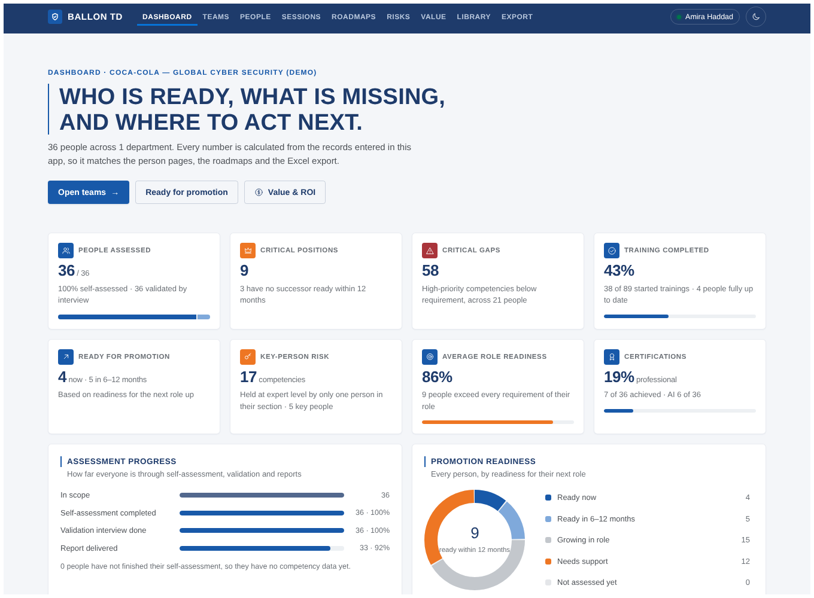

# Dashboard, Teams and Analysis

The manager dashboard that used to be a stand-alone page reading an Excel workbook now lives inside Ballon TD and reads the live database. It uses the same layout and components as before (KPI cards, funnel, donut, department cards, critical-positions band, 9-box, heatmaps, radar, day-by-day chart) in the app's navy and royal-blue style, light and dark. All numbers come from `server/lib/metrics.ts`, so they match the person pages, roadmaps, risks and the Excel export.

| Page | What it shows |
| --- | --- |
| **Dashboard** (`/dashboard`) | Eight headline cards (people assessed, critical positions, critical gaps, training completed, ready for promotion, key-person risk, role readiness, certifications), assessment progress, promotion readiness, one card per department, and the critical positions with their ready successors |
| **Teams** (`/teams`) | Everyone, one department or one section: KPI strip, most common gaps, promotion overview, training done by band and by assessment stage, key-person risk, the 9-box, readiness by department or section, the competency heatmap, the observed-behaviour heatmap and the full employee list (search, filter by band, sort) |
| **Person → Analysis** | Readiness rings (role and next role), critical gaps, key position, exceeds role, training done; competency radar against the role and the next role; what to grow for the next role with the descriptors of the target level; observed behaviours day by day with the trend line and trainer notes; training; certifications and the learning plan |

## Definitions

| Term | Definition |
| --- | --- |
| Band | From the readiness band: *Ready now* (next-role readiness ≥ 92 % and no critical gap), *6–12 months* (≥ 85 % and at most one critical gap), *Growing in role* (role readiness ≥ 85 %), *Needs support*, *Not assessed yet* |
| Critical gap | A High-priority competency below its required level |
| Critical position | A role profile of seniority Lead, Manager, Head or Executive, or a job title with Lead, Head, Director, Chief, Manager or CISO |
| Successor | Someone whose role profile's *next role* is the holder's role and who is ready now or in 6–12 months |
| Key person | The only person in their section (3 or more assessed people, critical positions not counted) at expert level in a competency: level 4, or the top of the scale when that is lower |
| No expert | A High-priority competency held by 3 or more people in a section where nobody is at expert level |
| Potential (9-box, up) | Average observed score (1–5) on the Leadership and Learning Agility behaviours. Cut-offs 2.8 and 3.4 |
| Performance (9-box, across) | Role readiness. Cut-offs 86 % and 95 % |
| Coachability | Average of openness to feedback, learning speed, applies feedback and reflection quality on the latest observed day |
| Heatmap cell | The assessed level, coloured by level − required (above, meets, 1 below, 2+ below). Above 80 people the heatmap shows sections with the average of level − required |

People marked Out of Scope or Left Company are left out.

## What changed from the workbook version

| Workbook dashboard | Now |
| --- | --- |
| Read eight sheets of an `.xlsx` in the browser | Reads the database through `GET /api/dashboard?clientId=&department=&section=` and `GET /api/people/:id/analysis` |
| Next role guessed from seniority inside the section | The role profile's *next role*, as everywhere else in the app |
| One organisation | Several clients: filter by client on every page |
| Hash routes, HTML strings | React pages and components (`pages/Dashboard.tsx`, `pages/Teams.tsx`, `components/analysis.tsx`, `components/charts.tsx`) |
| Lime accent | The app palette: navy, royal blue, steel gray; orange and red only for warnings and gaps |

Code: [`server/lib/dashboard.ts`](../server/lib/dashboard.ts).
