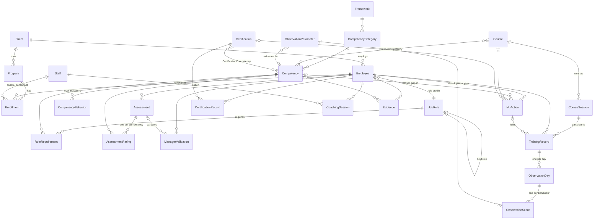

# Data model

The system is a **competency management system**: everything hangs off an **Employee** and a **Competency**. The full definition is [`prisma/schema.prisma`](../prisma/schema.prisma); field labels, lists and links are in [`shared/entities.ts`](../shared/entities.ts).

## The three kinds of data

| Kind | Who touches it | Tables |
| --- | --- | --- |
| **Reference** (~70%) | Set up once on Library, changed rarely | LookupValue, Client, Program, Staff, Framework, CompetencyCategory, Competency, CompetencyBehavior, JobRole, RoleRequirement, Course, CourseCompetency, Certification, CertificationCompetency, ObservationParameter |
| **Activity** (~20%) | Entered by the team, person by person or session by session | Employee, Enrollment, Assessment, AssessmentRating, ManagerValidation, IdpAction, CourseSession, TrainingRecord, ObservationDay, ObservationScore, CertificationRecord, CoachingSession, Evidence |
| **Calculated** (~10%) | Never typed, never stored | Gap, role readiness, next-role readiness, readiness band, plan progress, overdue, completion %, averages. Worked out on the fly and written to `Employee_Summary` in the export |

## Relationships

## What changed from the first draft (the Master Data Dictionary)

| Draft | Problem | Now |
| --- | --- | --- |
| `Required_Level` on every employee-competency row | 40 analysts carry the same number; one typo breaks the gap | **JobRole + RoleRequirement**: required level is set once per role. It is copied into each assessment's ratings (so history stays right if the role changes) and can be overridden per person |
| `EMPLOYEE_COMPETENCY` holds the current level | Re-assessing overwrites the start level, so progress cannot be shown | **Assessment + AssessmentRating**: every assessment (self, interview, re-assessment…) is its own record. "Current level" is calculated: the latest completed non-self rating |
| `Linked_Competency_ID` on trainings and certifications (one only) | A course usually builds several competencies | **CourseCompetency** and **CertificationCompetency** link tables (many-to-many) |
| `TRAINING_MASTER` and `WORKSHOP_MASTER` separate | Same thing; workshops are a training type | One **Course** table; `type` says Workshop / Instructor Led / Leadership Programme…; `observed` marks courses where trainers score behaviours |
| No run / date / trainer for a training | Attendance and scores belong to a specific run and day | **CourseSession** (one run: dates, trainer, batch) → **TrainingRecord** (one person on it) → **ObservationDay** (one day: attendance, notes, potential) → **ObservationScore** (one behaviour score). This matches the client's "Training Day Scores" sheet exactly |
| `EMPLOYEE_OBSERVATION` with Workshop_ID | Behaviours did not say which competency they evidence | **ObservationParameter.competencyId**: the 25 behaviours from the client's sheet keep their "Behaviour \| Competency" pairing |
| `Related_Activity_ID` on evidence could point anywhere | No way to know which table it points to | **Prefixed IDs** everywhere (TRN-000123, CER-0004, COA-0010…): the prefix names the table |
| `Coach_ID`, `Trainer_ID`, `Manager_ID` all to USER_MASTER | Line managers are client employees; coaches/trainers are our people | **Staff** = our people. Line managers and validating managers are **Employee** rows (or a name when they are not in the system) |
| Programme batch / dates on the employee | A person can do several cycles | **Program** (a client programme / IDP cycle) + **Enrollment** (person × programme, with batch, coach, consultant) |
| No client | One server, several client companies; exports must not mix them | **Client**; every employee belongs to one. Export can be limited to one client |
| No audit trail; no logins | With no logins, "who entered this" must still be known | Every activity row has **createdBy / updatedBy / source**, and every change is written to **ChangeLog** (old → new values) |
| USER_MASTER with roles | No logins or roles are needed | Dropped. People pick their name once ("Entering as …"); it is stored with every change |
| Separate IDP certification columns (Prof Cert / AI Cert) | Fixed number of columns | **CertificationRecord** rows; `Certification.track` = Professional / AI / Vendor |
| Learning plan "Segment 1…5 + estimated time" | Fixed number of columns | **IdpAction** rows with `actionType` "Learning Plan Segment" / "Department Training Need" and `estimatedHours` |

## Calculations

| Value | Definition |
| --- | --- |
| Current level | Latest completed assessment rating that is not a self-assessment; self-assessment only if nothing else exists |
| Gap | Required level − current level (positive = below requirement) |
| Critical gap | Gap > 0 on a High-priority competency |
| Role readiness | Σ weight × min(level, required) ÷ Σ weight × required, weights High 3 · Medium 2 · Low 1 |
| Next-role readiness | Same formula against the requirements of the role's "next role" |
| Readiness band | Ready for next role: next-role readiness ≥ 92% and no critical gaps · Ready in 6–12 months: ≥ 85% and ≤ 1 critical gap · Growing in role: role readiness ≥ 85% · Needs support: the rest |
| Plan progress | Average progress % of plan actions that are not cancelled |
| Overdue action | Planned end has passed and status is not Completed or Cancelled |
| Training completion | Completed ÷ (all trainings except Cancelled, Deferred, Expired) |
| Observed average | Average of all behaviour scores; also per competency through the behaviour → competency link |

The code is [`server/lib/metrics.ts`](../server/lib/metrics.ts).

## The Excel export

One workbook, built by [`server/lib/export.ts`](../server/lib/export.ts):

| Sheet | Rows | For |
| --- | --- | --- |
| `README` | — | What is in the file, row counts, ID prefixes |
| `Employee_Summary` | one per person | Reading: every calculated value (the manager's "one row per person" view) |
| `Activity_Log` | one per data point | Reading: every interaction of every type in one long sheet — ratings, validations, plan actions, trainings, each observation day and score, certifications, coaching, evidence. Filter by person to get their whole history |
| `Data_Dictionary` | one per column | Meaning, type, list and link of every column |
| one sheet per table | one per record | **Importing**: column names = database columns, IDs intact, every `…Id` column is a foreign key (also stated in the header cell's note) |
| `ChangeLog` | one per change | Optional; leave it out of files that go to the client |

Why both a long log and table sheets: one row per person with a column for every interaction breaks as soon as people have different numbers of trainings (Training_1 … Training_15, mostly empty) and cannot be imported. The long `Activity_Log` gives the "everything in one sheet" view; the table sheets keep the structure for the database. Calculated values are only in the two reading sheets, so an import never stores derived numbers.

## Moving to a bigger database later

The schema uses SQLite (one file, no server to install). To move to PostgreSQL or SQL Server: change `provider` in `prisma/schema.prisma`, swap the driver adapter in `server/db.ts`, and import the table sheets of a full export (or copy the data directly). IDs are strings, so nothing needs renumbering.
