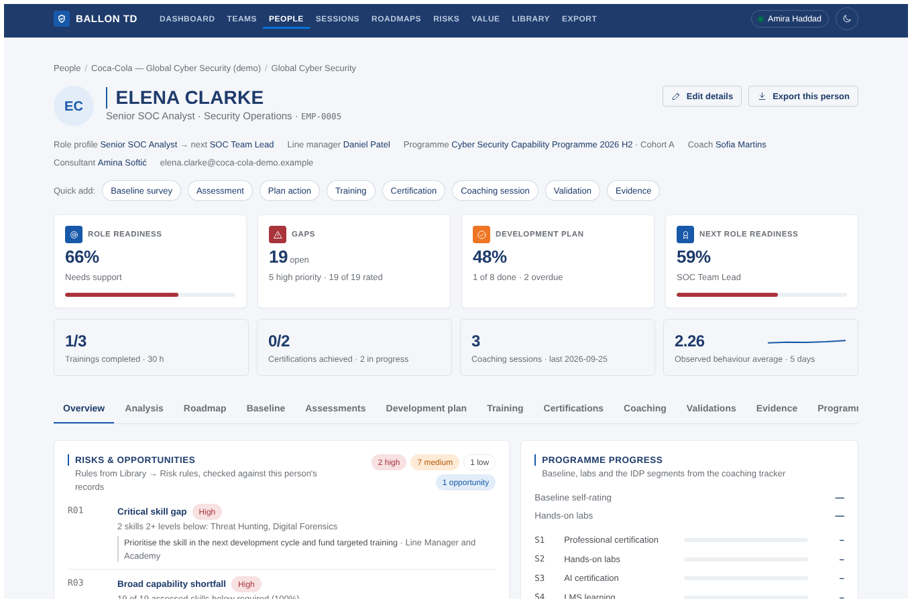
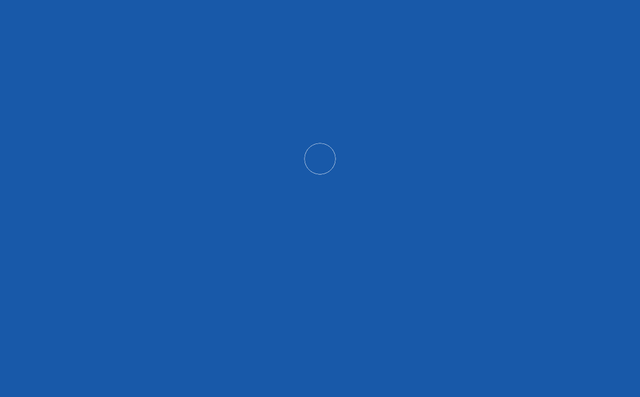

# Design

The app keeps its original layout and components (header, hero, KPI cards, filter chips, tables, tabs, drawers, the ratings and observation grids). What changed is the visual layer: a corporate blue palette, one plain typeface, capitalised titles and thin keylines. Everything lives in [`client/src/styles.css`](../client/src/styles.css): colour tokens at the top, component styles in the middle, the brand layer at the end.

## Colour

Blue dominates. Navy carries titles and the header, royal blue is the action and accent colour, and steel gray is the body text. The secondary colours appear only as status (warning, error, success) and in charts, never as decoration.

| Token | Hex | Used for |
| --- | --- | --- |
| `--navy` | `#1E3B6B` | Header bar, titles, figures, table header text |
| `--royal` | `#1859A9` | Primary buttons, accent, keylines, progress bars, active chips |
| `--cool-blue` | `#0075C9` | Info |
| `--sky-blue` | `#0773D7` | Active navigation marker |
| `--steel` | `#4D5156` | Body text |
| `--cool-gray` | `#9D9FA0` | — (reserved for charts) |
| `--sky-gray` | `#D4D2CF` | Quiet rules (action notes) |

Secondary colours, sparingly:

| Hex | Role |
| --- | --- |
| `#A9343A` red | Errors, *High* risks, critical gaps |
| `#EE7623` orange | Warnings, *Medium* risks, "needs support" band |
| `#FAA22C` bright orange | Warnings in the dark theme |
| `#00754A` green | The "online" dot |
| `#E32726` bright red | Error tint in the dark theme |

Positive statuses (Completed, Approved, Opportunity, High potential) use a pale-blue tag with royal-blue text rather than green, so the screen stays mostly blue.

**Dark theme.** A navy-black base (`#0C1729`, cards `#12223B`) with a lighter royal (`#2F7FD6`) for accents so it keeps contrast. Toggle with the sun/moon button; the choice is remembered per browser.

No gradients, glows or coloured shadows.

## Type

* **Arial** everywhere (Helvetica / Liberation Sans as fall-backs). No web fonts are loaded, so the app looks the same offline and inside the VPN.
* **Body leading = font size + 50 %** (`line-height: 1.5`).
* **Titles in capitals, extra bold** (`font-weight: 800`): page titles, card titles, drawer and modal titles, table headers, navigation.
* Labels in small capitals with letter spacing (KPI labels, filter labels, eyebrows).

## Keylines and frame

| Element | Rule |
| --- | --- |
| Vertical keyline | Royal-blue rule to the left of page titles, 4 % of the title size (minimum 2 px), and a 2 px rule beside card titles |
| Horizontal keyline | Royal-blue rule above the business name in the footer, 10 % of its text size |
| Frame | A 6 px white border around the whole window (navy-black in the dark theme) |
| Table header | 2 px royal-blue rule under the header row |

## Opening animation

Plays once each time the app is opened in a browser tab (not on reloads or page changes), before the app has even loaded, and works offline. It is plain HTML, CSS and SVG inside [`client/index.html`](../client/index.html).

| Time | What happens |
| --- | --- |
| 0 s | The screen is royal blue (`#1859A9`, the primary colour) |
| 0.1–1.1 s | A navy tile pops in, the shield outline draws itself in white, three rings ripple out, the check mark draws in sky blue and turns white |
| 0.7–1.1 s | The letters of BALLON TD rise one by one |
| 1.35–1.9 s | The sky-blue keyline grows under the name and *Development records* fades in |
| 2.1–3.0 s | The mark lifts and fades, and the blue background fades to transparent, revealing the app underneath |

Click or press any key to skip. With *reduce motion* switched on in the operating system it shows the mark still and fades out after a moment. `?intro=0` in the address skips it (used for screenshots).

## Components that were added

| Component | Where | Class names |
| --- | --- | --- |
| Risks & opportunities card | Person → Overview | `.flag-list`, `.flag`, `.flag-action` |
| Programme progress card | Person → Overview | `.kv`, `.seg-list`, `.seg` |
| Observation summary card | Person → Overview | `.kv`, `.seg-list`, `details` |
| Risks page | Top navigation | existing `.table`, `.filters`, `.kpi` |
| Stage rail | Person → Roadmap, Roadmaps | `StageRail` in `components/roadmap.tsx`: numbered nodes with a progress ring, joined by a line that turns royal blue as stages finish; *Now* badge on the current stage |
| Stage detail, next steps | Person → Roadmap | `.todo-list` with done (filled) and open (hollow, red when overdue) markers |
| Timeline | Person → Roadmap | `.tl` swimlanes by month, today line in sky blue |
| Journey strip | Roadmaps | `MiniRail`: ten blocks per person in a table row |
| Print layout | Roadmap pages | `@media print` hides navigation and prints cards and colours as shown |
| Dashboard, Teams, Analysis | Top navigation, Person → Analysis | `components/charts.tsx` (ring, donut, bar list, stacked bar, radar, line chart) and the heatmap, 9-box, department-card and critical-positions styles carried over from the stand-alone dashboard, recoloured to the palette |
| Waterfall, break-even bar, KPI cards | Value | `.waterfall`, `.be-bar`, `.kpi-card` (top rule royal blue, orange or red by status) |
| Severity tag | Everywhere a rule is shown | `Severity` in `components/ui.tsx` |
| Suggest input | Grade, division, department, section | `SuggestInput` in `components/entity.tsx` (`<datalist>`) |

They reuse the existing card, tag, progress-line and table styles.

## Excel export

The workbook uses the same palette: navy header rows on the reading sheets, pale-blue header fill on table sheets, royal-blue sheet tabs, steel-gray secondary text. Colours are set at the top of [`server/lib/export.ts`](../server/lib/export.ts).

## Changing the palette

Change the tokens at the top of `styles.css` (both the light `:root` block and the dark `:root[data-theme='dark']` block) and the four constants at the top of `export.ts`. Component styles only use tokens.
