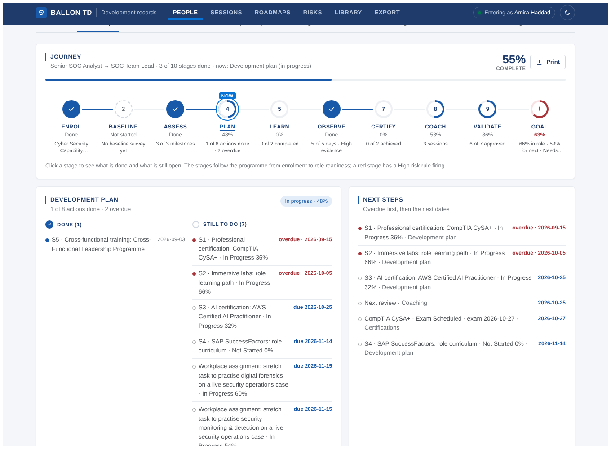
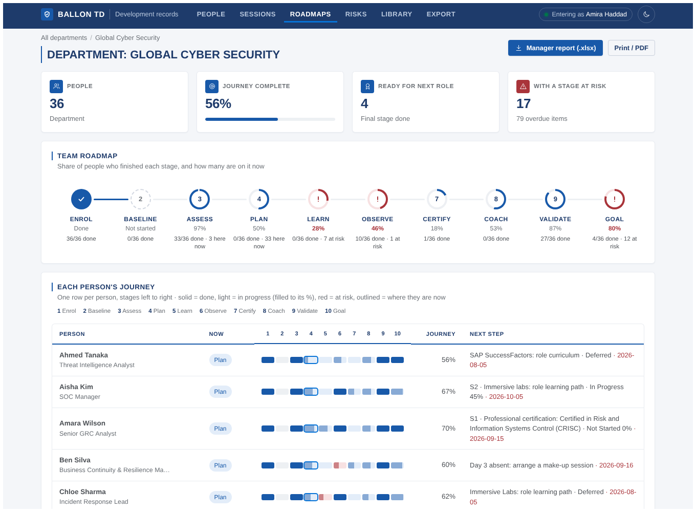

# Roadmaps

Once a person's data has been reported, the roadmap shows the journey they go through: ten stages from enrolment to role readiness, what they have already done in each stage, and what is still open. It is calculated from the records that already exist, so nothing extra has to be entered and no table was added. It is always up to date: add a coaching session or close a plan action and the roadmap moves.

| Where | What it shows |
| --- | --- |
| **Person → Roadmap** tab | One person's journey as a horizontal stage rail, the detail of the selected stage (done / still to do), next steps and a dated timeline |
| **Roadmaps** (top navigation) | The same rail rolled up per **department**, **section**, **line manager's team** or **client**, with one card per group |
| **Roadmaps → a group** | The team rail, one row per person with their ten stages side by side, and everything overdue or due in the next 60 days |
| **Manager report (.xlsx)** | The group's roadmap as a workbook the manager can keep (see below). **Print / PDF** prints the same page as a clean report |
| **Export** | `Roadmap` sheet: one row per person per stage |

## The ten stages

The order follows the programme. Each stage is **Done**, **In progress** (with a %), **At risk** (a High risk rule fires for it) or **Not started**.

| # | Stage | Done when | Progress | Still to do lists | Risk rules |
| ---: | --- | --- | --- | --- | --- |
| 1 | Enrolment | Enrolled in a programme (not Nominated or Withdrawn) | 0 or 100 % | Enrol, confirm status | — |
| 2 | Baseline survey | A baseline survey exists | 0 or 100 % | The survey before day 1 | — |
| 3 | Assessment & report | Self-assessment and validation interview completed, report delivered | milestones ÷ 3 | Each missing milestone with its status | R31–R33 |
| 4 | Development plan | Every plan action (not cancelled) completed | average action progress | Open actions with due dates (overdue in red); IDP segments S1–S5 / DTN that have no action | R21, R22, R25 |
| 5 | Training & labs | Every assigned course, LMS item and lab collection completed | per record: completed = 1, labs = completed ÷ total | Open records, labs done of total, no-shows | R19, R20, R24, R27–R29 |
| 6 | Observed programme | All days (5 by default) observed | observed days ÷ expected | Days not observed yet, absent days to make up | R11–R16 |
| 7 | Certifications | Every certification in the plan achieved | achieved ÷ planned | Open certifications with exam or target date; a missing professional or AI certification | R26 |
| 8 | Coaching | Segment progress on the coaching tracker reaches 100 % | average S1–S5 / DTN progress (else coaching progress) | Scheduled sessions, next review, segments below 100 % | R23, R30 |
| 9 | Manager validation | Every validation approved | approved ÷ all | Pending or rejected validations | — |
| 10 | Role readiness (the goal) | *Ready for next role* band, or 100 % readiness when no next role is set | (role readiness + next-role readiness) ÷ 2 | Each skill below the requirement (high priority first), unrated skills, next-role readiness | R01–R05, R07, R08 |

**Journey %** is the average over the ten stages, a done stage counting 100 %. **Now** marks the current stage: the first one in progress or at risk, otherwise the first not started. People marked Out of Scope or Left Company have no roadmap.

## Timeline

Below the stage detail, every dated record is placed on a month-by-month swimlane (assessment, plan, training, observation, certification, coaching, validation). Filled marks are done, hollow marks are planned, red marks are missed or overdue; plan actions and course sessions with a start and end are drawn as bars. The vertical line is today.

## Team view

A team stage counts how many people finished it, how many are on it now and how many are at risk. The person rows use a compact strip of ten blocks: solid = done, light = in progress (filled to its %), red = at risk, outlined = where they are now.

## The manager report

**Roadmaps → open a group → Manager report (.xlsx)** downloads:

| Sheet | Contents |
| --- | --- |
| `Summary` | People, average journey %, ready for next role, people with a stage at risk, and a table of the ten stages (done · in progress · at risk · not started · currently here · progress) |
| `People` | One row per person with goal, journey %, current stage and the ten stages as coloured cells; each cell's note lists what is still open. Ends with the next step and its date |
| `Still_open` | Everything still to do, overdue first, with dates |
| `Done` | Everything achieved, with dates |

The report is limited to the group (department, section, line manager's team or client) that is open on the page. For the whole client, open **Group by → Client**.

API: `GET /api/people/:id/roadmap`, `GET /api/roadmaps?groupBy=department|section|manager|client[&clientId=]`, `GET /api/roadmaps/group?groupBy=…&key=…`, `GET /api/roadmaps/report?groupBy=…&key=…`.

Code: [`server/lib/roadmap.ts`](../server/lib/roadmap.ts) (stages, timeline, roll-up), [`server/lib/roadmap-report.ts`](../server/lib/roadmap-report.ts) (manager workbook), [`client/src/components/roadmap.tsx`](../client/src/components/roadmap.tsx) (rail, stage detail, timeline, strip), [`client/src/pages/Roadmaps.tsx`](../client/src/pages/Roadmaps.tsx).
