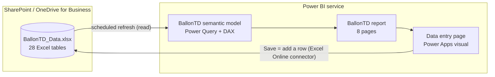

# Ballon TD in Power BI

The Power BI version of Ballon TD has three parts:
- **A semantic model and report** that read one Excel data workbook.
- **Power Apps input screens** that add rows to that same workbook.
- **The Power Apps visual**, which embeds those screens inside the report.

The Excel file is the database. Power BI reports on it. The screens write to it.



## What is in this folder

| Path | What |
| --- | --- |
| `BallonTD.pbip` | Open this in Power BI Desktop |
| `BallonTD.SemanticModel/` | The model in TMDL: 25 tables, 30 relationships, 34 measures, Power Query per table |
| `BallonTD.Report/` | The report in PBIR: Overview, People, Person, Competency gaps, Development plan, Training & observations, Coaching & validation, Data entry |
| `data/BallonTD_Data.xlsx` | The data workbook: one Excel table per database table, preloaded with the Coca-Cola Global Cyber Security demo (36 people) |
| `powerapps/*.yaml` | The input screens, one container per file, to paste into Power Apps Studio |
| `powerapps/SCREENS.md` | The same screens as a control list and formulas, for building them by hand |
| `MODEL.md` | Every table, column, relationship and measure |

## 1. Put the workbook in SharePoint or OneDrive

1. Upload `data/BallonTD_Data.xlsx` to a SharePoint document library (recommended for a team) or to OneDrive for Business.
2. Give everyone who will enter data **edit** access to the file. The input screens write as the signed-in user.
3. Open the file in Excel desktop, choose **File → Info → Copy path**, and keep that URL. Remove the `?web=1` ending if there is one.

## 2. Open the project in Power BI Desktop

1. Use a recent Power BI Desktop (2025 or later). PBIP, TMDL and PBIR are the default formats there. In older versions, turn on *File → Options → Preview features → Power BI Project (.pbip) save option* and *Store reports using enhanced metadata format (PBIR)*, then restart.
2. **File → Open** → `BallonTD.pbip`.
3. **Transform data → Edit parameters**:
   - To test with a local copy, set **DataFile** to its full path, e.g. `C:\BallonTD\BallonTD_Data.xlsx`.
   - To use the SharePoint file, set **DataFile** to the URL from step 1. Then open **Transform data**, select the **Workbook** query, and in the Advanced Editor switch the two `Source =` lines: comment out `File.Contents` and use `Web.Contents`.
4. **Refresh**. Sign in with your organisational account when asked about the SharePoint URL.

## 3. Publish and schedule refresh

1. **Publish** to a workspace.
2. In the service, open the semantic model's **Settings**:
   - Under **Data source credentials**, choose **OAuth2** with your organisational account. A SharePoint or OneDrive file needs no gateway; a local file does.
   - Turn on **Scheduled refresh** and pick times. Power BI Pro allows up to 8 a day; Premium or Fabric capacity allows more. Check your licence.

## 4. Add the input screens to the report

The screens are a Power Apps canvas app shown inside the report through the **Power Apps for Power BI** visual. Create the app from the visual, because that's what gives it `PowerBIIntegration`: the person you select in the report arrives pre-selected in the forms.

1. **Open the report in the Power BI service** (Edge or Chrome) and choose **Edit**. Microsoft recommends creating and editing the app from the service.
2. **Add the visual.** Go to the **Data entry** page. In the Visualizations pane, select **Power Apps for Power BI** and drag it over the "Power Apps visual goes here" box.
3. **Give it data.** Add **Employee › Employee ID** and **Employee › Full name** to its *Power Apps data* field.
4. **Create the app.** Choose **Create new**, pick your environment, and Power Apps Studio opens with a starter app.
5. **Connect the workbook.** Choose **Data → Add data → Excel Online (Business)**, select the SharePoint/OneDrive file, and tick these tables:
   - To read: `tbl_Employee`, `tbl_LookupValue`, `tbl_Staff`, `tbl_Competency`, `tbl_CompetencyBehavior`, `tbl_Course`, `tbl_CourseSession`, `tbl_Certification`, `tbl_ObservationParameter`, `tbl_TrainingRecord`.
   - To write: `tbl_CoachingSession`, `tbl_ManagerValidation`, `tbl_Evidence`, `tbl_IdpAction`, `tbl_TrainingRecord` (also read), `tbl_CertificationRecord`, `tbl_ObservationDay`, `tbl_ObservationScore`.

   If Power Apps offers to add a unique ID column (`__PowerAppsId__`), accept. The report ignores it.
6. **Raise the row limit.** In **Settings → General → Data row limit**, set **2000**. The Excel connector reads at most this many rows for lookups.
7. **Create the screens.** Add eight blank screens named exactly: `scrMenu`, `scrCoaching`, `scrValidation`, `scrEvidence`, `scrPlan`, `scrTraining`, `scrCertification`, `scrObs`. In the app's **Tree view**, drag `scrMenu` to the top so it opens first. You can delete the starter screen.
8. **Paste each file onto its screen:**

   | File | Screen |
   | --- | --- |
   | `00-Menu.yaml` | `scrMenu` |
   | `01-Coaching.yaml` | `scrCoaching` |
   | `02-Validation.yaml` | `scrValidation` |
   | `03-Evidence.yaml` | `scrEvidence` |
   | `04-Plan.yaml` | `scrPlan` |
   | `05-Training.yaml` | `scrTraining` |
   | `06-Certification.yaml` | `scrCertification` |
   | `07-Observation.yaml` | `scrObs` |

   For each one, open the file in a text editor, select all and copy. In Studio, select the screen in the Tree view and press **Ctrl+V**. Allow clipboard access the first time.
   If Studio refuses a paste, build that screen by hand from `powerapps/SCREENS.md`. It lists the same controls and formulas.
9. **Save and publish** the app (**File → Save**, then **Publish**). **Share** it with the people who enter data.
10. **Save the report** in the service.

### What each screen writes

| Screen | Writes to | Mirrors |
| --- | --- | --- |
| Coaching session | `tbl_CoachingSession` | The coaching table: date, 1-1 start/end, preparation, session and reporting minutes (total effort is calculated), session type, progress, notes per IDP segment |
| Line-manager validation | `tbl_ManagerValidation` | Monthly progress per skill, 1 Not started … 5 Fully achieved |
| Coach validation | `tbl_Evidence` | One row per behaviour descriptor: progress 1–5 plus the artefact or line-manager confirmation |
| Development action | `tbl_IdpAction` | IDP segments S1–S5, department training needs, workplace assignments |
| Training record | `tbl_TrainingRecord` | One person on one course or session |
| Certification record | `tbl_CertificationRecord` | S1 professional or S3 AI certification progress |
| Observation scores | `tbl_ObservationDay` + `tbl_ObservationScore` | The cross-functional table: one person, one day, the 25 behaviours, potential/risk note, assessor notes |

Every row gets:
- **An ID** with the table's prefix and `PA` plus a timestamp, e.g. `COA-PA261022143005`.
- **Dates as text**, e.g. `2026-10-22`.
- **`createdBy` / `updatedBy`** set to the signed-in user.
- **A `source`**, which you pick on the form.

## 5. When do new entries show up?

After the next refresh of the semantic model, either scheduled or **Refresh now** in the workspace. The visual can't refresh a report that imports from Excel. Microsoft documents that `PowerBIIntegration.Refresh()` works only with DirectQuery sources. The Excel connector can also take up to 30 seconds before a written row is visible.

If people need to see their entry immediately, add a Power Automate flow with **When Power Apps calls a flow (V2) → Refresh a dataset** and call it at the end of each Save button. Each run counts against your daily refresh limit.

## 6. Limits to plan for

| Limit | Value | What to do |
| --- | --- | --- |
| Excel file size (connector) | 25 MB | About 100,000 rows at this width. Archive old cycles into a second workbook. |
| Simultaneous edits | Not supported | Don't edit the workbook in Excel while people use the screens; the file can stay locked for up to 6 minutes after use. |
| Connector calls | 100 per minute per connection | Fine for normal data entry. The observation screen writes 26 rows per save. |
| Rows read by the app | Data row limit, max 2000 | Lookups only read people, lists and sessions, which stay small. |
| Records passed from the report to the app | 1000 | Only the selected person is needed. |
| Report Server, Embed for customers | Not supported for the Power Apps visual | Use the Power BI service or *Embed for your organization*. |

When the volume or the number of people entering data grows, keep the same screens and model and move the tables from Excel to SharePoint lists, Dataverse or a Fabric SQL database. That last option also opens Power BI's built-in write-back (translytical task flows), which doesn't support Excel.

## 7. Rebuilding and checking

From the repository root:

```bash
npm run db:coca-cola                               # (once) load the Coca-Cola demo into the app database
npm run powerbi:data -- --client "Coca-Cola"       # rebuild data/BallonTD_Data.xlsx from the app database
npm run powerbi:build                              # rebuild the model, report, screens, MODEL.md, SCREENS.md
SCHEMAS_DIR=/path/to/json-schemas npm run powerbi:validate
```

`powerbi:validate` runs these checks:
- Every Power Query expression parses with Microsoft's parser (`@microsoft/powerquery-parser`).
- Every DAX reference, relationship column and report field exists in the model.
- Every report JSON file matches Microsoft's PBIR schemas (with `SCHEMAS_DIR` set to a clone of [microsoft/json-schemas](https://github.com/microsoft/json-schemas)).
- Every control, data source and Patch column used by the screens exists.

The TMDL was also parsed with Microsoft's Tabular Object Model (the same `TmdlSerializer` Power BI uses), and the screens were checked against Microsoft's Power Apps YAML schema (pa.yaml v3).

What wasn't possible without Power BI Desktop and Power Apps Studio: running the queries, evaluating the DAX, rendering the pages and pasting the screens. Treat the first open in Desktop as the final check. If anything is off, the error message will name the table or visual.
